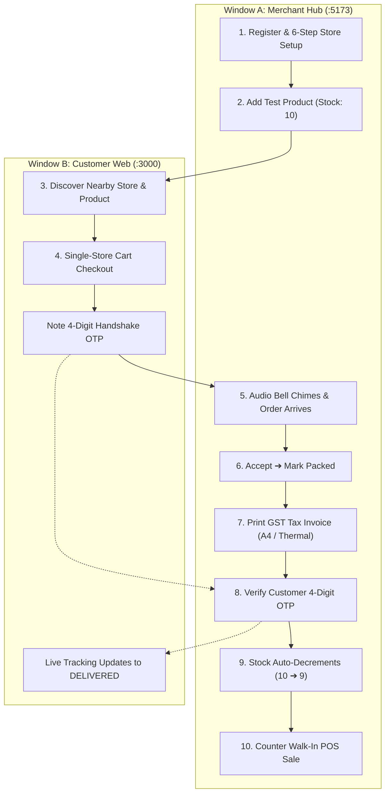

# 🧪 Manual End-to-End Commerce Testing Guide
**Document Purpose:** Complete founder's walk-through guide for verifying the platform locally before production launch.  
**Scope Covered:** Merchant Onboarding ➔ Cataloging ➔ Customer Discovery ➔ Cart & Checkout ➔ Audio Alerts ➔ Order Fulfillment ➔ 4-Digit OTP Delivery Handshake ➔ Counter POS Walk-in Billing.  
**Target Runtime:** Localhost Monolith (`apps/backend` on `:5000`, `apps/merchant` on `:5173`, `apps/web` on `:3000`).

---

## 📋 Pre-Flight Setup & Environment Verification

### 1. Boot All 3 Applications
Open your terminal in the workspace root and run:
```bash
pnpm dev
```
*(Alternatively, you can open 3 separate terminal tabs and run: `pnpm dev:backend`, `pnpm dev:merchant`, and `pnpm dev:web`)*

| Service | Local URL | Purpose |
|---|---|---|
| **Backend API Monolith** | `http://localhost:5000` | Express REST, Socket.io, MongoDB Atlas |
| **Merchant & Admin Hub** | `http://localhost:5173` | Vite React SPA for Retail Merchants |
| **Customer Web Storefront** | `http://localhost:3000` | Next.js 14 Customer Marketplace |

> [!IMPORTANT]
> **Use Two Separate Browser Windows:**  
> Open **Window A (Regular Browser)** for the **Merchant Panel** (`:5173`), and **Window B (Incognito / Private Window)** for the **Customer Storefront** (`:3000`).  
> This ensures that customer and merchant JWTs/cookies never conflict in local storage.

---

## 🗺️ Visual End-to-End Testing Workflow



---

## 🚀 Step-by-Step Testing Checklist

### Phase 1: Merchant Registration & Store Setup (Window A — `:5173`)

- [ ] **1.1 Register New Merchant Account**
  - Navigate to: `http://localhost:5173/register`
  - Enter:
    - **Full Name:** `Vikram Retailer`
    - **Email:** `vikram.store@example.com`
    - **Phone:** `9876543100`
    - **Password:** `Password@123`
  - Click **Create Merchant Account**. You will be automatically redirected into the **6-Step Store Onboarding Wizard**.

- [ ] **1.2 Complete 6-Step Onboarding**
  - **Step 1 (Basic Details):**
    - Store Name: `Apex Fashion & Lifestyle`
    - Category: Select `Fashion & Apparel`
    - Description: `Premium daily fashion and ethnic wear`
  - **Step 2 (Address & Geolocation):**
    - Address: `Shop 12, Civic Centre Market`
    - City: `Bhilai`, State: `Chhattisgarh`, PIN: `490006`
    - Pin location on the interactive map (or keep default Bhilai/Durg coordinates `[81.3509, 21.1938]`).
    - Delivery Radius: Set to `4 km`.
  - **Step 3 (Operating Hours):**
    - Toggle `Mon–Sun: 10:00 AM – 09:30 PM`.
  - **Step 4 (Legal & Taxation):**
    - Click **Verify GSTIN** (or use dummy `22AAAAA0000A1Z5`).
    - PAN: `ABCDE1234F`.
  - **Step 5 (Bank Account for Settlements):**
    - Bank Name: `HDFC Bank`, Account: `50100234567890`, IFSC: `HDFC0001234`.
  - **Step 6 (Review & Submit):**
    - Click **Submit Store for Approval**.
    - Notice instant transition into your live Merchant Dashboard (`http://localhost:5173/dashboard`)!

---

### Phase 2: Add Test Product to Catalog (Window A — `:5173`)

- [ ] **2.1 Navigate to Catalog Management**
  - In the left sidebar, click **Catalog / Products** (or go to `http://localhost:5173/catalog`).
  - Click the **+ Add Product** button.

- [ ] **2.2 Fill in Product Details**
  - **Product Name:** `Classic Oxford Cotton Shirt`
  - **Category:** `Fashion & Apparel`
  - **Sub-category:** `Shirts`
  - **Brand:** `Apex Studio`
  - **MRP:** `₹1,299`
  - **Selling Price:** `₹799` *(Shows 38% OFF badge automatically)*
  - **Stock Quantity:** `10`
  - **HSN Code:** `6205` (5% GST)
  - **Image:** Upload a product photo or pick one from sample assets.
  - Click **Save Product**.

- [ ] **2.3 Verify Initial State**
  - Confirm the product is visible in your catalog table.
  - Initial stock shows: `10 In Stock`.

---

### Phase 3: Customer Store Discovery & Cart Checkout (Window B — `:3000`)

- [ ] **3.1 Open Customer Storefront in Incognito**
  - Navigate to: `http://localhost:3000`
  - Click **Login / Sign Up** (top right) ➔ login with customer credentials (e.g. `arjun.customer@example.com` / `Password@123` or register a new shopper).

- [ ] **3.2 Hyperlocal Store Discovery**
  - Set location to **Bhilai / Durg** (or click "Detect Location").
  - On the homepage or Stores Directory (`http://localhost:3000/stores`), find **`Apex Fashion & Lifestyle`**.
  - Notice the **store card** displays:
    - Distance pill (e.g., `1.2 km`)
    - Estimated delivery time (`20–30 mins`)
    - Category badge (`Fashion & Apparel`)

- [ ] **3.3 Add Product to Cart**
  - Click on `Apex Fashion & Lifestyle` to view its dedicated storefront (`/stores/apex-fashion-lifestyle`).
  - Find your newly added **`Classic Oxford Cotton Shirt`**.
  - Click **Add to Cart**.
  - Notice the bottom bar / cart drawer slides open displaying:
    - Store: `Apex Fashion & Lifestyle`
    - Subtotal: `₹799`
    - Delivery Fee: `₹0 (Free Hyperlocal Delivery)`
    - Total: `₹838.95 (incl. 5% GST ₹39.95)`

- [ ] **3.4 Test Single-Store Cart Rule (Invariant Check)**
  - *(Optional)* Try navigating to a different store and clicking "Add to Cart".
  - Verify that a clear confirmation prompt appears: *"Your cart already contains items from Apex Fashion & Lifestyle. Clear cart to add items from this store?"* ➔ Click Cancel.

- [ ] **3.5 Place Order**
  - Click **Proceed to Checkout**.
  - Select or add a delivery address (e.g., `Plot 14, Nehru Nagar West, Bhilai`).
  - Payment Method: Select **Cash on Delivery (COD)**.
  - Click **Place Order**.

- [ ] **3.6 Note Order Confirmation & 4-Digit Delivery OTP**
  - The screen redirects to the **Order Confirmation & Live Tracking Page** (`/orders/[orderId]`).
  - **CRITICAL:** Locate the **4-digit Delivery Handshake OTP** prominently displayed (e.g., **`4821`**).
  - Also note the **Order Number** (e.g., `ORD-20261030-XXXXXX`).

---

### Phase 4: Merchant Real-time Order Processing (Window A — `:5173`)

- [ ] **4.1 Verify Real-time Order Arrival**
  - Switch back to **Window A** (`http://localhost:5173/orders`).
  - **Audio Check:** Listen for the order notification chime!
  - **Visual Check:** The **"New Orders"** tab badge updates to `(1)`.
  - The customer's order appears at the top of the list with status `NEW`.

- [ ] **4.2 Accept & Pack Order**
  - Click the order card to open the **Order Details Modal**.
  - Review customer name, delivery address, and ordered items.
  - Click **Accept Order** ➔ Status updates to `ACCEPTED`.
  - Click **Mark Packed / Ready to Ship** ➔ Status updates to `PACKED`.

- [ ] **4.3 Test Tax Invoice Printing Engine**
  - In the order details modal, click **Print Invoice**.
  - Test both formats:
    - **Standard A4:** Full statutory GST Tax Invoice with seller GSTIN, HSN summary, and customer billing address.
    - **Thermal ESC/POS (80mm):** Compact roll receipt format with store name, barcode, and clean item breakdown.

---

### Phase 5: 4-Digit Handshake OTP Verification & Completion

- [ ] **5.1 Perform Doorstep Delivery Handshake**
  - In the Merchant Order Modal (or using the Pilot Rider Web Runner at `http://localhost:3000/rider/run/[orderId]`), click **Verify Handshake OTP**.
  - Enter the **4-digit OTP** noted from the customer screen in Step 3.6 (e.g., `4821`).
  - Click **Complete Delivery**.

- [ ] **5.2 Verify Instant State Synchronizations**
  - **Merchant Panel:** Order status immediately transitions to **`DELIVERED`** 🟢.
  - **Customer Screen (Window B):** The live progress timeline updates in real time to **`Delivered`** with timestamp!
  - **Inventory Check (Window A ➔ Catalog):**
    - Go back to `http://localhost:5173/catalog`.
    - Check the `Classic Oxford Cotton Shirt`: stock has decremented from **`10` ➔ `9`**!

---

### Phase 6: Retail Walk-In Counter POS (Window A — `:5173`)

- [ ] **6.1 Navigate to In-Store Counter POS**
  - In the Merchant sidebar, click **Counter POS / Invoicing** (`http://localhost:5173/billing/pos`).

- [ ] **6.2 Add Walk-in Sale Items**
  - Use the quick search or 1-tap product grid to add `Classic Oxford Cotton Shirt` to the POS cart.
  - Notice automatic calculation of Base Price, HSN, and GST.

- [ ] **6.3 Tender & Instant Receipt**
  - Click **Cash Tendered** (or UPI QR).
  - Enter amount received ➔ click **Complete Sale**.
  - A thermal receipt preview pops up immediately with instant thermal printer support (`?autoPrint=true`).
  - Product stock in catalog decrements by another unit (from **`9` ➔ `8`**)!

---

## 🛠️ Quick Troubleshooting Reference

| Symptom | Cause | Resolution |
|---|---|---|
| Order bell doesn't chime in Merchant Panel | Browser autoplay policy blocked audio | Click anywhere on the Merchant panel once after opening to enable audio context. |
| Customer cart says *"Store is currently closed"* | Store operating hours or `isActive` toggle | Go to `http://localhost:5173/settings` and ensure store is marked **Active** and operating hours include current time. |
| OTP verification fails with `INVALID_OTP` | Typing error or stale order OTP | Check the exact 4-digit code shown in the customer's active order tracking header. |
| Port 5000 / 3000 / 5173 in use | Old background process | Run `Get-NetTCPConnection -LocalPort <port>` in PowerShell and kill PID, then restart `pnpm dev`. |

---

## 🎯 Verification Sign-Off Table

| Test Section | Verified Feature | Tested By | Date | Pass / Fail |
|---|---|---|---|:---:|
| **Section 1** | Merchant Signup & 6-Step Onboarding | Founder / User | Oct 30, 2026 | [ ] |
| **Section 2** | Catalog Product Creation & Stock Setting | Founder / User | Oct 30, 2026 | [ ] |
| **Section 3** | Customer Storefront Discovery (2dsphere) | Founder / User | Oct 30, 2026 | [ ] |
| **Section 4** | Single-Store Cart & Checkout Submission | Founder / User | Oct 30, 2026 | [ ] |
| **Section 5** | Merchant Real-time Order Bell & Invoicing | Founder / User | Oct 30, 2026 | [ ] |
| **Section 6** | 4-Digit Handshake OTP & Stock Decrement | Founder / User | Oct 30, 2026 | [ ] |
| **Section 7** | Walk-in Counter POS Billing & Thermal Print | Founder / User | Oct 30, 2026 | [ ] |
