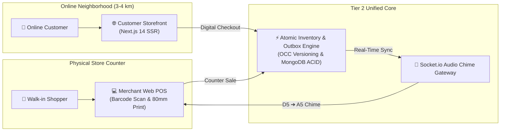
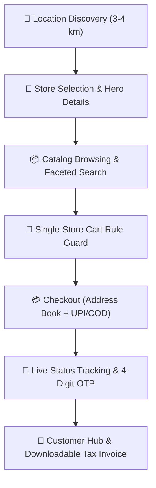
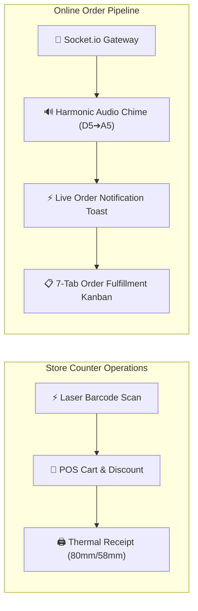
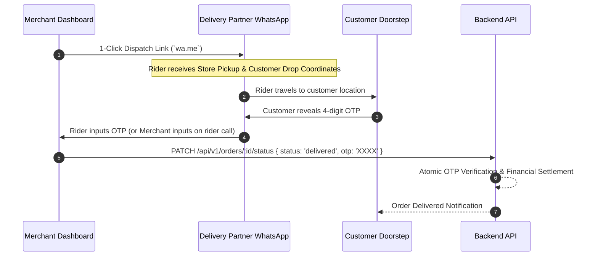
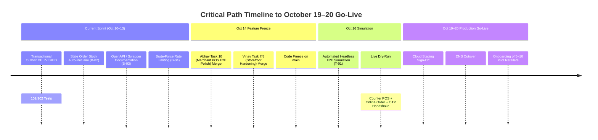

# 🚀 TIER 2 PLATFORM LAUNCH SPECIFICATION
## Hyperlocal Retail Operations, Dual-Channel POS Billing & Pilot Storefront Ecosystem

**Document Ref:** `TIER-2-LAUNCH-SPEC-2026`  
**Target Milestone:** October 14 (Feature Freeze) ➔ October 16 (E2E Simulation) ➔ October 19–20 (Go-Live)  
**Deployment Scope:** Cloud Staging Sign-Off & Onboarding of 5–10 Pilot Retailers  
**Platform Architecture:** White-Label Modular Monolith (`apps/backend`) + Customer Storefront (`apps/web`) + Merchant Panel & POS (`apps/merchant`)  
**Status:** Canonical Release Specification  

---

## 1. Executive Summary & Strategic Mission

The **Tier 2 Launch** represents the transformative bridge between standard online e-commerce and physical brick-and-mortar retail operations. 

While **Tier 1** delivered the foundational online marketplace (store discovery, digital cart checkout, WhatsApp delivery dispatch, and order invoices), **Tier 2** solves the core **"Hybrid Commerce Dilemma"**: enabling physical shopkeepers to run their everyday walk-in counter billing on the platform while simultaneously exposing their shelf inventory to nearby online shoppers (3–4 km radius) with **zero risk of double-selling, inventory drift, or dropped notifications**.



---

## 2. Three-Tier Scope Boundary Matrix

To maintain clear engineering boundaries and prevent scope creep during the October 14–20 launch window, the platform enforces strict tier partitioning:

| Functional Area | 🌟 Tier 1 (Delivered Sept) | 🚀 Tier 2 (Current Launch Scope — Oct 14–20) | 🏛️ Tier 3 (Post-Launch Expansion — Nov) |
|---|---|---|---|
| **Customer Storefront** | Hyperlocal 3–4 km discovery, single-store cart, checkout | Refined mobile/desktop UX, order tracking, downloadable bill | Native Mobile App (React Native / Expo), saved cards |
| **Merchant Order Processing** | 7-tab order processing pipeline (`NEW` ➔ `DELIVERED`) | **Real-time Socket.io audio chime alert (D5➔A5)** + alert toast | Auto-dispatch kitchen display systems & cloud thermal printers |
| **In-House Retail POS Billing** | *None (Online orders only)* | **Rapid POS Counter Terminal (Folder 5)**: Barcode scan, manual billing, estimates (`Q-`), GST invoices (`INV-`), ESC/POS thermal print | Multi-series enterprise ledgers, Tally/Zoho Books sync |
| **Inventory Concurrency** | Basic stock check on order submit | **Atomic Dual-Channel Lock**: Walk-in sales instantly decrement online availability via OCC | Multi-warehouse routing, supplier purchase orders |
| **Delivery Coordination** | WhatsApp dispatch link + 4-digit customer OTP handshake | Formatted WhatsApp payloads + delivery verification | Continuous 5s GPS telematics (`GEOADD`), pooled rider app |
| **Outbox & Event Dispatch** | Direct inline event publishing | **Transactional Outbox Worker** (`outboxWorker.ts`) with reentrancy guard & auto-retry | Distributed Kafka/RabbitMQ event streams |
| **Accounting & Tax** | Online order invoice (`INV-ORD-xxxxx`) | Full Indian GST math (CGST/SGST/IGST), sequential bill series | Formal GSTR-1 / GSTR-3B filings, Credit/Debit notes |
| **Financial Settlement** | Order price breakdown & payment mode (UPI/COD) | Cash drawer reconciliation per shift | Automated T+1 bank payouts (Razorpay Route) & TDS 194-O |
| **Pilot Onboarding** | Internal mock validation | **5–10 Real Brick-and-Mortar Retailers** live on-ground | City-wide multi-cluster commercial rollout |

---

## 3. Comprehensive Feature Breakdown by User Role

### A. Customer End (`apps/web` — Storefront)

The customer storefront is a responsive Next.js 14 App Router application optimized for sub-second page loads, mobile viewports (`<768px`), and desktop layouts (`≥1024px`).



#### 1. Hyperlocal Discovery & Geofencing
* **Auto-Location Detection**: HTML5 Geolocation with reverse geocoding to Indian metros and localities.
* **Store Pinning**: Interactive Leaflet / Google Maps selector to define customer delivery location.
* **Proximity Filtering**: Strict 3–4 km delivery radius enforcement backed by MongoDB `2dsphere` spatial indexing. Stores outside the radius are grayed out or excluded from delivery.

#### 2. Store & Catalog Experience
* **Store Showcase**: High-res storefront banner, operating hours, delivery fee badges, merchant ratings, and verified badge.
* **Faceted Product Discovery**: Search by keyword, category, subcategory, brand, and price range.
* **Product Detail Pages (PDP)**: Multi-image carousels, rich descriptions, unit/weight specifications, MRP vs Selling Price discount percentage tags, and live in-stock badges.
* **SKU Variant Matrix**: Interactive size, color, and pack-size selectors with real-time price and stock updates.

#### 3. Single-Store Cart Engine
* **Strict Single-Store Invariant**: A cart can only contain items from one store at any given time.
* **Cross-Store Conflict Guard**: Attempting to add an item from Store B while holding items from Store A opens an interactive modal: *"Replace cart items? Your cart contains items from [Store A]. Clear cart and start fresh?"*
* **Live Price Breakdown**: Real-time calculation of item total, applicable store discounts, delivery fees, and grand total.

#### 4. Checkout & Order Handshake
* **Delivery Address Book**: Add, edit, select, and set default delivery addresses with landmark tags (Home, Work, Other).
* **Payment Modes**: Seamless selection between Cash on Delivery (COD) and Online UPI / Cards.
* **Order Creation Handshake**: Atomic stock validation on submission. Immediate redirection to the live Order Confirmation & Tracking screen.

#### 5. Order Tracking & Customer Hub
* **Visual Progress Tracker**: Real-time status tracker (`PLACED` ➔ `CONFIRMED` ➔ `PACKED` ➔ `OUT_FOR_DELIVERY` ➔ `DELIVERED`).
* **Secure Delivery OTP**: Large-format 4-digit delivery handshake PIN prominently displayed. Customers hand this PIN to the delivery partner upon physical receipt.
* **Printable / Downloadable Bill**: Dedicated customer invoice view (`INV-ORD-xxxxx`) matching GST standards with 1-click printable receipt.

---

### B. Merchant / Store Cashier End (`apps/merchant` — Panel & POS)

The Merchant application is a high-speed Vite + React 18 SPA built with Tailwind CSS, Lucide icons, and Shadcn/UI primitives. It serves as both the operational back-office and the high-speed counter POS terminal.



#### 1. Real-Time Socket.io Alert Gateway & Audio Chime
* **Persistent WebSocket Channel**: Automatically authenticates and joins store-scoped room `store:${storeId}`.
* **Harmonic Melodic Chime Engine (`audioAlert.ts`)**: Built entirely on HTML5 Web Audio API oscillators. Synthesizes a pleasant, penetrating two-tone notification melody ($D_5 \approx 587.33\text{ Hz} \longrightarrow A_5 \approx 880.00\text{ Hz}$) with zero external MP3 assets.
* **Persistent Controls**: Sound preview button ("✨ Test Sound"), volume slider, and audio mute toggle persisted in browser `localStorage`.
* **Instant Action Toast (`LiveOrderSocketListener.tsx`)**: High-contrast amber alert banner displaying order number, customer name, total items, and price with a 1-click *"View & Accept Order"* deep link.

#### 2. In-House Retail POS Counter Terminal (Folder 5 Mockups)
* **Rapid Barcode Scanner Buffer**: Global keystroke burst listener detects hardware HID USB/Bluetooth barcode scanner inputs ($< 50\text{ms}$ interval) and automatically routes scanned EAN-13/UPC codes to the active bill without requiring text input focus.
* **Manual Quick-Search**: Rapid product autocomplete by title, SKU, or category for non-barcoded goods.
* **Flexible Counter Billing Modes**:
  * **Tax Invoice (`INV-`)**: Full GST invoice with customer name, phone number, and optional GSTIN.
  * **Commercial Estimate / Quote (`Q-`)**: Quick price quote with validity timer; features 1-click `+ Convert to Invoice`.
* **Settlement Modes**: Multi-tender support (Cash, UPI QR, Card, Split Payment).
* **ESC/POS Direct Thermal Receipt Engine**: Generates raw ESC/POS bytecode (`generateEscposReceiptBuffer`) supporting both 80mm and 58mm thermal rolls with store branding, itemized taxes, and customer footer.

#### 3. 7-Tab Online Order Fulfillment Pipeline
* **Lifecycle Tabs**:
  1. `New Orders` (Unconfirmed arrivals requiring merchant acceptance)
  2. `Confirmed` (Merchant accepted order; order moves to preparation)
  3. `Ready to Ship` / `Packed` (Items packaged and bagged with customer invoice attached)
  4. `Out for Delivery` / `Shipped` (Dispatched with internal staff or third-party delivery partner)
  5. `Delivered` (Successful handover verified by customer OTP)
  6. `Cancelled` (Order cancelled with reason code; inventory automatically restored)
  7. `All Orders` (Master searchable history with date/status filters)
* **1-Click WhatsApp Delivery Dispatch**: Automatically constructs and launches pre-formatted WhatsApp messages to delivery partners with order ID, customer phone, pickup address, drop-off location, and map coordinates.

#### 4. Product Catalog & Live Stock Adjustments
* **Wizard-Driven Cataloging**: Add single products or multi-variant matrices (sizes, colors, weights).
* **Instant Stock Adjustment Drawer**: Adjust physical stock counts with reason codes (`Physical Count Audit`, `Damaged / Expired`, `Supplier Restock`).
* **Category & Pricing Hierarchy**: Set MRP, Selling Price, Tax Rate (0%, 5%, 12%, 18%, 28%), and HSN/SAC codes.

#### 5. Merchant Onboarding & Profile Management
* **6-Step Self-Serve Registration (`register.<domain>`)**: Business profile, store location pin-drop, operating schedule, FSSAI / GSTIN / PAN documentation upload, and bank payout details.

---

### C. Delivery Partner / Courier End (Dispatch & Handshake)

Tier 2 utilizes an agile, frictionless WhatsApp-driven dispatch model that eliminates the requirement for delivery partners to install a heavy native app during the initial pilot phase:



#### 1. Frictionless WhatsApp Dispatch Links
* **Dynamic Deep Links**: Formatted `https://wa.me/<rider_phone>?text=...` URI generated dynamically by the merchant panel.
* **Formatted Dispatch Manifest**: Includes Order ID (`#ORD-xxxxx`), Store Name, Store Pickup Address, Customer Drop Address, Google Maps Navigation Pin, Delivery Fee, Payment Mode (Cash to Collect / Prepaid), and Customer Contact.

#### 2. Cryptographic 4-Digit Handshake OTP
* **Doorstep Verification**: To prevent false delivery claims, the customer provides a 4-digit OTP shown in their tracking screen.
* **Verification Gate**: The backend rejects status transitions to `DELIVERED` unless the exact cryptographic OTP matches. Successful verification triggers order completion and inventory settlement.

---

### D. Platform Operator / Admin End (`apps/merchant` Admin View & API)

* **Merchant Verification Queue**: Review submitted merchant onboarding applications, inspect uploaded business proofs (PAN/GST/FSSAI), and approve/reject stores.
* **Global Order Auditing**: Full platform visibility over active orders across all participating pilot merchants.
* **White-Label Branding Engine**: All platform branding (app name, logo, support emails, primary palette) dynamically managed through `branding.config.ts` and environment variables.

---

## 4. Backend Engine & Enterprise Architectural Guarantees

The Tier 2 backend is a Node.js + Express modular monolith built with strict enterprise invariants:

### 1. Atomic Dual-Channel Concurrency & Deadlock Prevention
To prevent race conditions where an in-store customer purchases an item at the counter while an online customer checks out the same item, the system executes atomic conditional mutations in [`catalog.service.ts`](file:///d:/UTKARSH/Live%20Projects/Vercel-live-Website/platform-root-vz/apps/backend/src/modules/catalog/catalog.service.ts):

```typescript
// Deterministic sorting prevents circular database deadlocks
const ordered = [...items].sort((a, b) =>
  (a.sku ?? a.productId).localeCompare(b.sku ?? b.productId),
);

for (const item of ordered) {
  const result = await ProductModel.updateOne(
    {
      _id: item.productId,
      'variants.sku': item.sku,
      'variants.stock': { $gte: item.quantity }, // Prevents negative inventory
      isActive: true,
    },
    {
      $inc: {
        'variants.$.stock': -item.quantity,
        totalStock: -item.quantity,
        version: 1, // Optimistic Concurrency Control (OCC)
      },
    },
    { session } // Multi-Document ACID Transaction
  );

  if (result.modifiedCount !== 1) {
    throw AppError.conflict(
      `Insufficient inventory or concurrent modification for variant ${item.sku}.`,
      'STOCK_UPDATE_CONFLICT'
    );
  }
}
```

### 2. Transactional Outbox Pattern & Background Drain Worker
To ensure zero dropped events between MongoDB transactions and external brokers (Redis Pub/Sub, Socket.io broadcasts, WhatsApp webhooks):
* State changes write an `outbox` record inside the same MongoDB ACID transaction.
* [`outboxWorker.ts`](file:///d:/UTKARSH/Live%20Projects/Vercel-live-Website/platform-root-vz/apps/backend/src/shared/database/outboxWorker.ts) polls every 5,000ms with a strict reentrancy guard (`isProcessing`), exponential backoff (up to 8 retries), unref timer, and graceful shutdown hooks in `server.ts`.

### 3. Statutory Indian GST Calculation Engine
Built natively into [`billing.service.ts`](file:///d:/UTKARSH/Live%20Projects/Vercel-live-Website/platform-root-vz/apps/backend/src/modules/billing/billing.service.ts):
* **State Normalization**: Parses 2-digit Indian State Codes (e.g., `07` for Delhi, `27` for Maharashtra, `29` for Karnataka) to determine Intra-State vs Inter-State supply.
* **Intra-State**: Applies equal split of CGST (50%) and SGST (50%).
* **Inter-State**: Applies full IGST (100%).
* **Tax Modes**: Handles both Tax-Exclusive and Tax-Inclusive pricing calculations.
* **Sequential Numbering**: Thread-safe atomic counters for Tax Invoices (`INV-YYYY-XXXX`), Quotes (`Q-YYYY-XXXX`), Credit Notes (`CN-YYYY-XXXX`), and Debit Notes (`DN-YYYY-XXXX`).

### 4. Infrastructure Resource Clamping
* **MongoDB Connection Pool**: Clamped to `maxPoolSize: 25`, `minPoolSize: 5`, and `serverSelectionTimeoutMS: 5000` to prevent Atlas connection exhaustion under spike loads.
* **Fault-Tolerant Redis Layer**: In-memory LRU cache fallback automatically activates if Redis is unreachable, guaranteeing zero user-facing 500 errors.

---

## 5. Quality Health & Verification Metrics

* **Automated Unit & Integration Tests**: **102 / 102 passing tests** across 16 test suites (`pnpm test`).
* **Monorepo Build Integrity**: Full clean build across all 5 workspace packages in $< 6\text{s}$ (`pnpm build`).
* **Strict White-Label Architecture**: Zero hardcoded client brand strings in backend APIs, models, frontend templates, or mock datasets.
* **IP Protection**: Maintained under dual-repo synchronisation with `.gitignore` shielding internal development roadmaps.

---

## 6. Critical Path Rollout Timeline



---

## 7. Summary for Project Leadership

* **For the Founder (Harish):**
  Tier 2 delivers the complete working hybrid retail experience. Pilot store owners can bill walk-in customers on 80mm thermal printers with barcode scanners while simultaneously fulfilling online hyperlocal orders without inventory discrepancies.
* **For the Corporate Consultant (Rajesh):**
  Every core enterprise reliability pillar (ACID multi-document transactions, deadlock-free inventory sorting, Optimistic Concurrency Control, Transactional Outbox pattern, and bounded connection pooling) is implemented and verified by 102 automated tests.
* **For the Technical Head (Utkarsh):**
  The system is resilient, decoupled, and strictly on track for the October 14 Feature Freeze, October 16 Simulation, and October 19–20 Go-Live.
