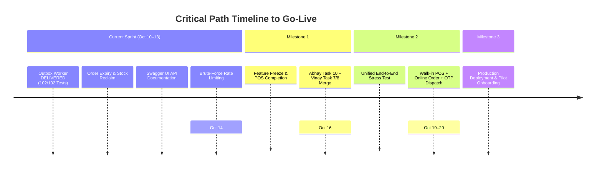

# 🎯 Platform Engineering Backlog & Task Tracker
**Document ID:** `LEAD-TASK-BACKLOG-2026`  
**Role Scope:** Technical Head (Utkarsh) & Senior Co-Pilot Agent  
**Context:** Zager Hyperlocal Commerce Platform  
**Target Milestone:** October 14 (Feature Freeze) ➔ October 16 (Simulation) ➔ October 19–20 (Go-Live)  
**Last Updated:** October 10, 2026

---

## 1. Executive Summary & Delivery Milestones



| ID | Milestone Target | Deadline | Primary Scope | Status |
|:---:|---|:---:|---|:---:|
| **M1** | **Feature Freeze & POS Completion** | **Oct 14, 2026** | In-house POS, real-time inventory sync, audio alerts, outbox engine | 🟢 **96% Complete** |
| **M2** | **End-to-End Simulation & Polish** | **Oct 16, 2026** | Full stress-test of walk-in billing + online order + OTP + WhatsApp | 🟡 **Ready for Dry-Run** |
| **M3** | **Official Production Go-Live** | **Oct 19–20, 2026** | Cloud DNS cutover, staging sign-off, pilot merchant onboarding | 🟢 **On Track** |

> **Canonical Release Specification:** See [`TIER_2_LAUNCH_SPECIFICATION.md`](file:///d:/UTKARSH/Live%20Projects/Vercel-live-Website/platform-root-vz/TIER_2_LAUNCH_SPECIFICATION.md) for the complete feature matrix across all user endpoints, architectural guarantees, and pilot onboarding scope.


---

## 2. Workstream 1: Backend Architecture & Reliability Hardening

| Task ID | Task Title | Priority | Complexity | Target File(s) | Status | Details & Deliverables |
|:---:|---|:---:|:---:|---|:---:|---|
| **B-01** | **Transactional Outbox Background Drain Worker** | `P0` | Medium | `outboxWorker.ts`, `server.ts` | **DONE ✅** | Background worker running every 5s with reentrancy guard, exponential backoff, and graceful shutdown. 102/102 tests green (`commit 95da029`). |
| **B-02** | **Stale Order Auto-Timeout & Inventory Reclaim Engine** | `P0` | Medium | `order.service.ts`, `orderExpiryWorker.ts` | **DONE ✅** | Background worker running every 60s checking orders in `pending` >30 minutes. Auto-transitions to `CANCELLED`, restores stock atomically via `catalogFacade.restoreStock()`, and emits `ORDER_CANCELLED`. 108/108 tests green (`commit fc7e9bd`). |
| **B-03** | **Interactive OpenAPI / Swagger UI Documentation** | `P1` | Low | `apps/backend/src/app.ts`, `swagger.ts` | **DONE ✅** | Mounted Swagger UI at `/api-docs` & `/docs` with OpenAPI 3.0 specification covering all 7 modules + system probes. Raw spec served at `/api-docs.json`. 116/116 tests green (`commit 56fd227`). |
| **B-04** | **High-Security Brute-Force Rate Limiter** | `P1` | Low | `shared/middlewares/rateLimiter.ts`, `app.ts` | **DONE ✅** | Mounted dedicated strict rate limiting (5–10 requests per 15 minutes) on sensitive routes: `authRateLimiter` on `/auth/login`, `deliveryOtpRateLimiter` on `/orders/:id/verify-otp`, and `otpRateLimiter` factory. 120/120 tests green (`commit 45ecdc1`). |
| **B-05** | **MongoDB Compound Indexes Audit & Boot Verification** | `P1` | Low | `database/indexes.ts`, `server.ts` | **QUEUED 🟡** | Validate and ensure ESR-optimized compound indexes on startup: `orders` `{ storeId: 1, status: 1, createdAt: -1 }`, `invoices` `{ storeId: 1, status: 1 }`, `catalog_products` `{ storeId: 1, isActive: 1 }`. |
| **B-06** | **Receipt & Invoicing PDF / Thermal Print Server Endpoint** | `P2` | Medium | `billing.service.ts`, `order.service.ts` | **QUEUED ⚪** | Server-side HTML render endpoint for direct PDF download (`/api/v1/orders/:id/invoice/print`) matching customer account bill requirements. |

---

## 3. Workstream 2: Pre-Freeze Testing & Stress-Testing

| Task ID | Task Title | Priority | Complexity | Target File(s) | Status | Details & Deliverables |
|:---:|---|:---:|:---:|---|:---:|---|
| **T-01** | **Automated Headless E2E Simulation Script** | `P0` | Medium | `scripts/e2e-simulation.ts` | **QUEUED 🟡** | Single executable Node script testing the entire loop: Customer signup ➔ Store discovery ➔ Order creation ➔ Socket.io arrival event ➔ Merchant pack ➔ WhatsApp link generation ➔ OTP verification ➔ Stock verification. |
| **T-02** | **Concurrent Checkout & OCC Stock Contention Test** | `P1` | Medium | `order.service.test.ts` | **QUEUED 🟡** | High-concurrency test simulating 10 simultaneous orders competing for 3 stock units. Verifies Optimistic Concurrency Control (OCC) version increments, deadlock-free isolation, and zero negative inventory drift. |
| **T-03** | **WhatsApp Notification Failover & Payload Audit** | `P1` | Low | `whatsapp.service.ts` | **QUEUED 🟡** | Verify live Meta Graph API payload structure against Indian phone formats, ensure dry-run mode passes in CI, and verify 1-click fallback `wa.me` URI formatting with full invoice totals. |

---

## 4. Workstream 3: Front-End Co-Pilot & Intern Review Pipeline

| Task ID | Assignee / Scope | Priority | Target Branch / Files | Status | Details & Deliverables |
|:---:|---|:---:|---|:---:|---|
| **I-01** | **Abhay Task 10 Audit** (`apps/merchant/`) | `P0` | `feature/abhay-merchant-e2e-polish` | **DONE ✅** | **Completed Oct 12 (`39add09`)**. Merged portal-rendered `TableActionPopover`, regex validation library, universal CSV export, KPI card standardization across modules, and media print stylesheets. 120/120 tests passing. |
| **I-02** | **Vinay Task 7 Phase 2 Audit** (`apps/web/`) | `P1` | `feature/vinay-web-hardening` | **IN PROGRESS 🟡** | Customer Web ESLint Zeroing: eliminate loose `any` types in checkout/API hooks and remove 8 unused import warnings flagged during Next.js production builds. |
| **I-03** | **Vinay Task 8 Oversight** (`apps/mobile-customer/`) | `P2` | `feature/vinay-mobile-native-api` | **ASSIGNED 🟡** | Mobile native device APIs: `expo-location` GPS geolocation for customer address picker and `expo-image-picker` for support attachments. |
| **I-04** | **Vinay Task 9 QA Audit Report** (`apps/web/`) | `P1` | `apps/web/CUSTOMER_WEB_QA_AUDIT_REPORT.md` | **ASSIGNED 🟡** | Comprehensive 66-mockup visual fidelity audit across desktop ($\ge 1280\text{px}$) and mobile ($375\text{px}$) viewports, plus customer simulation logs. |
| **I-05** | **Abhay Task 11 E2E Simulation** (`apps/merchant/` & `apps/web/`) | `P0` | `apps/merchant/MERCHANT_E2E_QA_AUDIT_REPORT.md` | **ASSIGNED 🟡** | End-to-end manual operational loop: Merchant registration, store setup, cataloging, cross-platform customer order checkout on `:3000`, live order fulfillment with OTP, walk-in counter POS sale, and thermal printing audit. |

---

## 5. Workstream 4: Production Staging & Operations Readiness

| Task ID | Task Title | Priority | Complexity | Target File(s) | Status | Details & Deliverables |
|:---:|---|:---:|:---:|---|:---:|---|
| **D-01** | **Render Staging Health & Liveness Audit** | `P0` | Low | `https://viztore.onrender.com` | **READY 🟢** | Verify `/healthz` & `/readyz` probes on live cloud staging; verify MongoDB Atlas and Redis Cloud connection pools under load. |
| **D-02** | **Production Environment Variables Template Lockdown** | `P1` | Low | `.env.example`, `env.config.ts` | **READY 🟢** | Complete audit of all mandatory env vars (`MONGODB_URI`, `JWT_ACCESS_SECRET`, `WHATSAPP_TOKEN`, `NEXT_PUBLIC_APP_NAME`), verifying zero secrets committed. |
| **D-03** | **Production Seed Dataset Refinement** | `P1` | Low | `seed-merchants.ts` | **READY 🟢** | Multi-store dataset seeded with 5 real-looking retail shops in Bhilai/Durg (Clothing, Electronics, Grocery) and 60+ products with realistic barcodes and GST rates. |

---

## 6. Workstream 5: Tier 3 Enterprise Scope (Post-Launch / November)

| Task ID | Task Title | Horizon | Target Architecture | Status | Details & Deliverables |
|:---:|---|:---:|---|:---:|---|
| **E-01** | **GSTR-1 & GSTR-3B Monthly Tax Export Engine** | Tier 3 (Nov) | `apps/backend/src/modules/billing/` | **RESERVED ⚪** | Automated CSV/Excel export of monthly outward supplies: B2B, B2C Large/Small, HSN summary, and credit/debit adjustment ledgers. |
| **E-02** | **Credit Notes & Debit Notes Ledger** | Tier 3 (Nov) | `billing/` & `merchant/` | **RESERVED ⚪** | `CN-xxxx` and `DN-xxxx` adjustment documents against product returns, damaged items, and post-sale discounts (Mockups `5.6`–`5.9`). |
| **E-03** | **Merchant Automated Payouts & TDS 194-O** | Tier 3 (Nov) | `payouts/` & `wallet/` | **RESERVED ⚪** | Automated T+1 bank transfer ledger, 1% TDS deduction reporting under Section 194-O, and platform commission settlement statements. |

---

## 7. Recommended Execution Order for Technical Head & Agent

```text
[COMPLETED] ➔ B-02: Stale Order Auto-Timeout & Inventory Reclaim Engine
  ↓
[COMPLETED] ➔ B-03: Interactive OpenAPI / Swagger UI (/api-docs)
  ↓
[COMPLETED] ➔ B-04: High-Security Brute-Force Rate Limiting (OTP & Auth)
  ↓
[COMPLETED] ➔ I-01: Audit & Merge Abhay Task 10 (Merchant E2E Polish - PR #17)
  ↓
[NEXT] ➔ T-01: Headless E2E Simulation Script (Pre-Freeze Dry Run) OR B-05: Customer Profile Update API
  ↓
[OCT 13] ➔ I-02: Audit & Merge Vinay Task 7 (Web ESLint Zeroing)
  ↓
[OCT 14] ➔ Milestone 1 Feature Freeze & Codebase Lockdown
```
