# Comprehensive Team Testing Audit & Remediation Backlog

## 1. Overview & Triage Protocol
This document serves as the master engineering log for all findings, functional gaps, and UI/UX defects uncovered during the team's full-day testing session.

**Execution Rule**: All items are registered, classified, and agreed upon first. Implementation proceeds sequentially based on the prioritized roadmap once triage is complete.

---

## 2. Summary Dashboard & Distribution

| Layer | Total Logged | Critical (P0) | High (P1) | Medium (P2) | Low (P3) | Status |
|---|:---:|:---:|:---:|:---:|:---:|---|
| **Customer Storefront (`apps/web`)** | 23 | 2 | 16 | 5 | 0 | 🟡 Triaged |
| **Merchant Hub (`apps/merchant`)** | 26 | 5 | 15 | 6 | 0 | 🟡 Triaged |
| **Rider Portal (`apps/rider` / Fleet)** | 1 | 0 | 1 | 0 | 0 | 🟡 Triaged |
| **Backend & Core Engine (`apps/backend`)** | 4 | 2 | 2 | 0 | 0 | 🟡 Triaged |
| **Cross-Cutting / Global System** | 8 | 1 | 7 | 0 | 0 | 🟡 Triaged |
| **TOTAL** | **62** | **10** | **41** | **11** | **0** | **Ready for Review** |

---

## 3. Master Items Registry Table

| ID | Title | Layer | Module | Type | Severity | Complexity | Status |
|---|---|---|---|---|:---:|:---:|:---:|
| `AUDIT-001` | Broken Product Actions: Wishlist / "Like" Heart Unresponsive | Customer Web | Wishlist / PDP | Bug / Defect | P1 | Medium | Logged 📝 |
| `AUDIT-002` | Merchant Broadcast Action Timing & Prominence | Merchant Hub | Orders / Fleet | UX / Workflow | P1 | Low | Logged 📝 |
| `AUDIT-003` | Customer Storefront Search Bar Not Returning Results | Customer Web | Discovery / Search | Bug / Defect | P0 | Medium | Logged 📝 |
| `AUDIT-004` | Customer vs. Merchant Account Segregation & Namespace | Backend | Auth / Identity | Architecture | P0 | High | DONE ✅ |
| `AUDIT-005` | Rider Portal Geolocation Accuracy & Advancement | Rider Portal | Delivery Fleet | Enhancement | P1 | High | Logged 📝 |
| `AUDIT-006` | Customer "Reserve / Hold" In-Store Order Pipeline | Customer Web / Backend | Orders / Reserve | Functional Gap | P1 | Medium | Logged 📝 |
| `AUDIT-007` | Customer Mobile Homepage Header Icons Inactive | Customer Web | Navigation | Bug / Defect | P1 | Low | Logged 📝 |
| `AUDIT-008` | Merchant Onboarding GSTIN Auto-Fill & PAN Correlation | Merchant Hub | Onboarding | UX / Validation | P2 | Low | Logged 📝 |
| `AUDIT-009` | Merchant Catalog Bulk Product Deletion Action | Merchant Hub | Catalog | Functional Gap | P1 | Medium | Logged 📝 |
| `AUDIT-010` | Flexible Category-Specific HSN Code Mapping | Merchant Hub | Catalog / Billing | Improvement | P2 | Low | Logged 📝 |
| `AUDIT-011` | Dynamic Category-Specific Product Attributes | Merchant Hub | Catalog | Functional Gap | P1 | Medium | Logged 📝 |
| `AUDIT-012` | Order Arrival Product Physical Location / Aisle Tagging | Merchant Hub | Orders / Warehouse | Feature | P2 | Medium | Logged 📝 |
| `AUDIT-013` | Duplicate Account Prevention on Identity Attributes | Backend | Auth / Identity | Security / Data | P0 | Medium | DONE ✅ |
| `AUDIT-014` | Merchant Manual "Create Order" Blocker: Customer Search ReadOnly & Form Missing | Merchant Hub | POS / Orders | Bug / Blocker | P0 | Medium | Logged 📝 |
| `AUDIT-015` | Merchant Catalog Filter & Search State Breakdown | Merchant Hub | Catalog | Bug / Defect | P1 | Low | Logged 📝 |
| `AUDIT-016` | Catalog Edit Product Modal Glitches & Field Binding | Merchant Hub | Catalog | Bug / Defect | P2 | Low | Logged 📝 |
| `AUDIT-017` | Inventory Module Hardening & Catalog Synchronization | Merchant Hub | Inventory | Bug / UX | P0 | High | DONE ✅ |
| `AUDIT-018` | Store Management "New Arrivals" Section Sequencing | Merchant Hub | Storefront CMS | Bug / Defect | P1 | Medium | Logged 📝 |
| `AUDIT-019` | Store Management Logo, Banner & Mobile Banner Saving | Merchant Hub | Media / Settings | Bug / Defect | P0 | Medium | Logged 📝 |
| `AUDIT-020` | "Your Store Link" 404 Routing on Public Storefront | Merchant Hub / Web | Storefront URLs | Bug / Defect | P0 | Low | Logged 📝 |
| `AUDIT-021` | Store QR Code Generation Pending & Inactive | Merchant Hub | Storefront CMS | Functional Gap | P1 | Low | Logged 📝 |
| `AUDIT-022` | Store Management Radio Button Direct Click Event | Merchant Hub | Storefront CMS | UI / Defect | P2 | Low | Logged 📝 |
| `AUDIT-023` | "Manage Sections" Changes Not Persisting on Save | Merchant Hub | Storefront CMS | Bug / Defect | P1 | Medium | Logged 📝 |
| `AUDIT-024` | Marketing Website "Sell Online" Nav Tab Hover Activation | Merchant Hub | Marketing Nav | UI/UX Polish | P3 | Low | Logged 📝 |
| `AUDIT-025` | Expense Module: New Vendor, Date Default & Amount Glitch | Merchant Hub | Expenses | Bug / Defect | P1 | Medium | Logged 📝 |
| `AUDIT-026` | Global System Date & Timezone Synchronization | Cross-Cutting | Core / Runtime | Reliability | P1 | Medium | Logged 📝 |
| `AUDIT-027` | "Stores Near You" Ascending Distance Proximity Sorting | Customer Web | Discovery | Algorithm / UX | P1 | Medium | Logged 📝 |
| `AUDIT-028` | Merchant Order Management: One-Click Accept & Print Invoice/KOT | Merchant Hub | Orders | Workflow | P1 | Low | Logged 📝 |
| `AUDIT-029` | "Shop by Category" Visual Polish & Card Layout Upgrade | Customer Web | Discovery / Home | UI/UX Polish | P2 | Low | Logged 📝 |
| `AUDIT-030` | Header "My Orders" & "Cart" Navigation / Quick View Triggers | Customer Web | Header Nav | Bug / Defect | P1 | Low | Logged 📝 |
| `AUDIT-031` | Broken Product Actions: PDP & Card "Share" Button Inactive | Customer Web | Social / PDP | Bug / Defect | P1 | Low | Logged 📝 |
| `AUDIT-032` | Customer Order Cancellation Button & Action Flow | Customer Web | Orders / Account | Functional Gap | P1 | Medium | Logged 📝 |
| `AUDIT-033` | Terms & Conditions / FAQ Collapsible Accordions Inactive | Customer Web | Legal / CMS | Bug / Defect | P2 | Low | Logged 📝 |
| `AUDIT-034` | Fashion & Promotional Hero Banner Carousel Polish | Customer Web | Home / Hero | UI/UX Polish | P2 | Low | Logged 📝 |
| `AUDIT-035` | Customer `/stores` Page Category Filter Tabs Breakdown | Customer Web | Stores Discovery | Bug / Defect | P1 | Low | Logged 📝 |
| `AUDIT-036` | Recommendation Duplication in "More Products For You" / "You May Also Like" | Customer Web | PDP / Algorithm | Bug / UX | P1 | Medium | Logged 📝 |
| `AUDIT-037` | Store Management "Section Preview Order" Ugly Native Scrollbar | Merchant Hub | Storefront CMS | UI / Defect | P2 | Low | Logged 📝 |
| `AUDIT-038` | Global Number Input UX Polish: Spinners, Scroll Lock & Stubborn 0 | Cross-Cutting | Forms / Inputs | UI/UX Polish | P1 | Medium | Logged 📝 |
| `AUDIT-039` | Merchant Catalog Tags / Keywords Container Click-to-Focus & Highlight | Merchant Hub | Catalog / Wizard | UI / Defect | P2 | Low | Logged 📝 |
| `AUDIT-040` | Stale May 2024 Date Defaults, Static Payout Headers & Double Calendar Icon | Cross-Cutting | Forms / Dates | Bug / UX | P1 | Medium | Logged 📝 |
| `AUDIT-041` | Master Taxonomy Engine, Dynamic Schema-Driven Attributes & HSN Lookup | Cross-Cutting | Catalog Core | Architecture / P0 | P0 | High | DONE ✅ |
| `AUDIT-042` | Customer Web Mobile Top Header Redundant Profile Icon Removal | Customer Web | Header Nav | UI / Redundancy | P2 | Low | Logged 📝 |
| `AUDIT-043` | Customer Web Mobile Search Row Notification Bell & Profile Navigation Handlers | Customer Web | Header Nav | Bug / Defect | P1 | Low | Logged 📝 |
| `AUDIT-044` | Customer Web Trust & Value Proposition Badges Horizontal Series Layout Alignment | Customer Web | Home / Trust Strip | UI/UX Polish | P2 | Low | Logged 📝 |
| `AUDIT-045` | Delivery Location Modal Background Bleed, Stacking Context Glitch & Saved Address Search | Customer Web | Location / Modal | Bug / Stacking | P0 | Medium | Logged 📝 |
| `AUDIT-046` | Merchant Dashboard "Create New Bill" Quick Action Buttons Routing & Intent Wiring | Merchant Hub | Billing / Dashboard | UX / Workflow | P1 | Low | Logged 📝 |
| `AUDIT-047` | Merchant Dashboard Overview Full Interactive Hardening: Quick Actions, Date Filters & Chart CTAs | Merchant Hub | Dashboard Overview | UX / Interactive | P1 | Medium | Logged 📝 |
| `AUDIT-048` | Customer "Favourite Stores" Pipeline Broken: Auto-Favoriting All Stores, Missing Heart Action & Zero Persistence | Customer Web | Account / Stores Discovery | Bug / Pipeline Breakdown | P1 | Medium | Logged 📝 |
| `AUDIT-049` | Customer & Platform End-to-End Notification Pipeline Breakdown: Backend Event ID Mismatch, Unwired Store & Permanent Empty State | Customer Web / Backend | Account & Header Notifications | Bug / Architectural Pipeline | P1 | Medium | Logged 📝 |
| `AUDIT-050` | Customer & Platform End-to-End Coupons & Offers Pipeline Breakdown: Mock Customer Page, Browser Prompt Checkout & Missing Backend Engine | Customer Web / Cross-Cutting | Coupons / Checkout / Marketing | Bug / Architectural Pipeline | P1 | Medium | Logged 📝 |
| `AUDIT-051` | Merchant Hub Route-Based Navigation Overhaul: Browser Back Button, Deep Linking & Refresh State Recovery | Merchant Hub | Routing & Architecture | Architecture / UX Blocker | P0 | High | DONE ✅ |
| `AUDIT-052` | Customer Dynamic Category Route Architecture (`/category/[slug]`), Faceted Query Parameters & Deep Linking Hardening | Customer Web | Catalog Discovery / Routing | Architecture / Enhancement | P1 | Medium | Logged 📝 |
| `AUDIT-053` | Platform End-to-End Returns & Refunds Pipeline Breakdown: Mock Merchant Table, Dead Action Modals & Missing Backend Return Engine | Cross-Cutting | Returns & Refunds / Orders | Bug / Architectural Pipeline | P1 | High | Logged 📝 |
| `AUDIT-054` | Merchant Customer CRM & Khata Ledger Pipeline Breakdown: Mock Customer Seed Data, Stale May 2024 Ledgers & Missing Backend Customer Engine | Cross-Cutting | Customers / CRM / Khata Ledger | Bug / Architectural Pipeline | P1 | High | Logged 📝 |
| `AUDIT-055` | Merchant Billing & Invoicing End-to-End Pipeline Breakdown: Unwired Backend APIs, In-Memory Mutations & Date Filter Disconnection | Merchant Hub | Billing & Invoicing | Bug / Architectural Pipeline | P1 | High | Logged 📝 |
| `AUDIT-056` | Merchant Payouts & Settlements Pipeline Breakdown: Hardcoded May 2024 Overview, Inconsistent Zero Balances & Missing Backend Settlement Engine | Merchant Hub | Payouts & Settlements | Bug / Architectural Pipeline | P1 | High | Logged 📝 |
| `AUDIT-057` | Merchant Settings & Store Configuration Breakdown: In-Memory "Save Changes", Hardcoded "Fashion Hub" Previews, Dual Verified/Verify Badges & Zero Backend Persistence | Merchant Hub | Settings & Profile | Bug / Architectural Pipeline | P1 | High | Logged 📝 |
| `AUDIT-058` | Merchant Purchase & Expense Procurement Breakdown: Hardcoded May 2024 Cards & Seed Ledger, Silent In-Memory API Fallbacks & Missing Backend Purchase Order/E-Way Engine | Merchant Hub | Purchase & Expense | Bug / Architectural Pipeline | P1 | High | Logged 📝 |
| `AUDIT-059` | Platform Support & Help Desk Pipeline Breakdown: Mock May 2024 Tickets, Dead Customer Action Cards, Discarded Attachments & Missing Backend Support Engine | Cross-Cutting | Support & Help Desk | Bug / Architectural Pipeline | P1 | High | Logged 📝 |
| `AUDIT-060` | Customer Profile & Account Management Breakdown: Unsaved Profile Mutations, Mocked Feedback Submissions & Dead "Sell Online" CTA | Customer Web | Account Hub | Bug / Functional Gap | P1 | Medium | Logged 📝 |
| `AUDIT-061` | Customer Cart & Checkout Multi-Store Layout Inconsistency & Fragile Address Validation | Customer Web | Cart & Checkout | Bug / UX Fragility | P1 | Medium | Logged 📝 |
| `AUDIT-062` | Merchant Global Header Search Bar Inactivity (`Ctrl+K`) & Disconnected Query Pipeline | Merchant Hub | Header Navigation | Bug / Defect | P1 | Low | Logged 📝 |

---

## 4. Deep-Dive Item Specifications

### Category A: Customer Web Storefront (`apps/web`)

#### [AUDIT-001] Broken Product Actions: Wishlist / "Like" Heart Unresponsive
- **Layer**: Frontend (`apps/web`) & Backend API (`/api/v1/users/wishlist`)
- **Module**: Wishlist / PDP / Product Cards
- **Type**: Bug / Defect | **Severity**: P1 | **Complexity**: Medium
- **Problem**: Clicking heart/like icon on individual product cards or product detail pages does not respond; items fail to persist in customer wishlist.
- **Expected**: One-tap optimistic UI toggle on heart icon with lively red fill animation, persistent sync across customer sessions, and single-click "Move to Cart".
- **Target Files**: `apps/web/src/components/product/ProductCard.tsx`, `apps/web/src/stores/wishlistStore.ts`, `apps/backend/src/modules/users/user.controller.ts`.

#### [AUDIT-003] Customer Storefront Search Bar Inactive & Non-Responsive
- **Layer**: Frontend (`apps/web`) & Backend API (`/api/v1/catalog/search`)
- **Module**: Discovery / Search Header
- **Type**: Bug / Defect | **Severity**: P0 | **Complexity**: Medium
- **Problem**:
  1. Querying text in main search bar does not trigger filtered catalog results or autocomplete suggestions.
  2. In mobile header (`apps/web/src/components/layout/SearchBar.tsx`), the `<input>` element lacks `value`, `onChange`, `onKeyDown`, and form submission handlers; pressing Enter or typing does not navigate to `/search?q=...` or update results (*Reported in User(1).docx item 4: "Search bar work nhi kr rha h"*).
  3. Voice search mic button is static and non-interactive.
- **Expected**: Debounced search query triggers live dropdown suggestions (stores, categories, products) and pressing Enter navigates to search results page with matching items sorted by relevance; mobile SearchBar input is fully interactive with route navigation.
- **Target Files**: `apps/web/src/components/layout/SearchBar.tsx`, `apps/web/src/components/layout/Header.tsx`, `apps/web/src/app/search/page.tsx`, `apps/backend/src/modules/catalog/catalog.service.ts`.

#### [AUDIT-006] Customer "Reserve / Hold" In-Store Order Pipeline
- **Layer**: Frontend (`apps/web`) & Backend (`apps/backend`)
- **Module**: Orders / Checkout / Reserve Mode
- **Type**: Functional Gap | **Severity**: P1 | **Complexity**: Medium
- **Problem**: Customers choosing "Reserve for In-Store Pickup" cannot complete checkout; pipeline fails or lacks reservation timeout state.
- **Expected**: Explicit checkout toggle: "Deliver Hyperlocal (3-4km)" vs. "Reserve for Store Pickup (Hold 2 Hours)". Creating reservation generates reserve code `#RES-XXXXX` and reserves stock without immediate online payment.
- **Target Files**: `apps/web/src/components/checkout/`, `apps/backend/src/modules/orders/order.service.ts`.

#### [AUDIT-007] Customer Mobile Homepage Header Icons Inactive
- **Layer**: Frontend (`apps/web`)
- **Module**: Mobile Navigation / Header
- **Type**: Bug / Defect | **Severity**: P1 | **Complexity**: Low
- **Problem**: On mobile viewport (<768px), header action icons (Location drawer, Notification bell, Cart counter, Search trigger) do not trigger intended modals or routes.
- **Expected**: Smooth tap targets opening location picker modal, cart slideover, and search drawer.
- **Target Files**: `apps/web/src/components/layout/MobileHeader.tsx`, `apps/web/src/components/layout/Navbar.tsx`.

#### [AUDIT-027] "Stores Near You" Ascending Distance Proximity Sort
- **Layer**: Customer Web (`apps/web`) & Backend Spatial Query (`apps/backend`)
- **Module**: Hyperlocal Discovery / Stores Near You
- **Type**: Algorithm / UX | **Severity**: P1 | **Complexity**: Medium
- **Problem**: Stores listed on customer discovery page and Home "Stores Near You" section are not sorted in strict ascending proximity (near to far), causing stores with further delivery times or arbitrary order to appear first (*Reported in User(1).docx item 5: "Shops near you m shops distance wise dikhata jaye"*).
- **Expected**: All verified stores within the 3–4 km hyperlocal radius must populate, sorted strictly by ascending real-time haversine distance (`0.3 km / 10 mins`, `0.8 km / 12 mins`, `1.5 km / 15 mins`), with clean distance and ETA badges matching mockups.
- **Target Files**: `apps/backend/src/modules/stores/store.repository.ts`, `apps/backend/src/modules/stores/store.service.ts`, `apps/web/src/features/home/components/NearbyStores.tsx`, `apps/web/src/app/stores/page.tsx`.

#### [AUDIT-029] "Shop by Category" Visual Polish & Card Layout Upgrade
- **Layer**: Frontend (`apps/web`)
- **Module**: Home / Category Discovery
- **Type**: UI/UX Polish | **Severity**: P2 | **Complexity**: Low
- **Problem**: Category cards look basic or unaligned, lacking modern glassmorphism, category iconography, and smooth micro-hover elevations.
- **Expected**: Modern responsive grid/carousel of category tiles with curated pastel backgrounds, high-res crisp category icons, badge counts, and smooth hover scale.
- **Target Files**: `apps/web/src/components/home/CategorySection.tsx`.

#### [AUDIT-030] Header "My Orders" & "Cart" Navigation / Quick View Triggers
- **Layer**: Frontend (`apps/web`)
- **Module**: Header Navigation
- **Type**: Bug / Defect | **Severity**: P1 | **Complexity**: Low
- **Problem**: Clicking "My Orders" in the header fails to route to the orders list, or clicking Cart does not open the cart slideover drawer.
- **Expected**: Header links must route cleanly to `/account/orders` and trigger the interactive quick cart drawer slideover.
- **Target Files**: `apps/web/src/components/layout/Header.tsx`.

#### [AUDIT-031] Broken Product Actions: PDP & Card "Share" Button Inactive
- **Layer**: Frontend (`apps/web`)
- **Module**: Product Details (PDP) / Product Cards / Social
- **Type**: Bug / Defect | **Severity**: P1 | **Complexity**: Low
- **Problem**: Clicking the "Share" button on individual products or PDP is completely unresponsive.
- **Expected**: Trigger native Web Share API (`navigator.share`) on mobile devices, or copy clean link to clipboard with an animated confirmation toast ("Link copied to clipboard! 📋") on desktop.
- **Target Files**: `apps/web/src/components/product/ProductShareButton.tsx`, `apps/web/src/components/product/ProductCard.tsx`.

#### [AUDIT-032] Customer Order Cancellation Action & Reason Modal
- **Layer**: Frontend (`apps/web`) & Backend API
- **Module**: Customer Account / Orders
- **Type**: Functional Gap | **Severity**: P1 | **Complexity**: Medium
- **Problem**: Customer has no way to cancel an order from the tracking page when the order is in `pending` or `confirmed` status; cancel button is missing or non-functional.
- **Expected**: Active "Cancel Order" button visible only while order is `pending` or `confirmed` (before `packed`/`shipped`); clicking opens cancellation reason modal, sends `POST /api/v1/orders/:id/cancel`, and updates UI state instantly.
- **Target Files**: `apps/web/src/app/account/orders/[id]/page.tsx`, `apps/backend/src/modules/orders/order.controller.ts`.

#### [AUDIT-033] Terms & Conditions / FAQ Collapsible Accordions Inactive
- **Layer**: Frontend (`apps/web` / marketing)
- **Module**: Legal & Policies CMS
- **Type**: Bug / Defect | **Severity**: P2 | **Complexity**: Low
- **Problem**: Clicking collapsible accordion sections in Terms & Conditions, Privacy Policy, or FAQs fails to expand/collapse the section body.
- **Expected**: Smooth animated Radix UI / Tailwind accordion disclosure with rotating chevron icon and accessible keyboard navigation.
- **Target Files**: `apps/web/src/app/terms/page.tsx`, `apps/merchant/src/pages/marketing/legal/TermsPage.tsx`.

#### [AUDIT-034] Fashion & Promotional Hero Banner Carousel Polish
- **Layer**: Frontend (`apps/web`)
- **Module**: Home / Hero Banner
- **Type**: UI/UX Polish | **Severity**: P2 | **Complexity**: Low
- **Problem**: Promotional fashion carousel transitions abruptly, lacks auto-play pausing on hover, or displays distorted aspect ratios on mobile.
- **Expected**: Polished multi-slide hero carousel with smooth sliding/fade animations, touch swipe support on mobile, indicator dots, and responsive banner height.
- **Target Files**: `apps/web/src/components/home/HeroBannerCarousel.tsx`.

#### [AUDIT-035] Customer `/stores` Page Category Filter Tabs Breakdown
- **Layer**: Frontend (`apps/web`)
- **Module**: Store Discovery
- **Type**: Bug / Defect | **Severity**: P1 | **Complexity**: Low
- **Problem**: On the dedicated `/stores` directory page, clicking category tabs (e.g., Grocery, Fashion, Electronics) does not filter the displayed stores.
- **Expected**: Interactive category pill tabs that instantaneously filter the store cards list with an active blue badge indicator and zero-state message if no store matches the category.
- **Target Files**: `apps/web/src/app/stores/page.tsx`.

#### [AUDIT-036] Recommendation Duplication in "More Products For You" / "You May Also Like"
- **Layer**: Frontend (`apps/web`) & Backend Recommendation API
- **Module**: Product Details (PDP) / Recommendations
- **Type**: Bug / UX | **Severity**: P1 | **Complexity**: Medium
- **Problem**: If a store category only has a single item, the "More products for you" or "You may also like" section repeatedly duplicates that exact same item across all card slots just to fill screen space.
- **Expected**: 
  - Strict de-duplication: Never repeat the same product card.
  - Graceful fallback: If category inventory is low (< 4 items), automatically broaden recommendations to other active items from the same store or popular trending items from the same locality.
  - Zero-state guard: If the store genuinely has only 1 product, render a clean "Explore other stores nearby" banner rather than repeating the single product 4–6 times.
- **Target Files**: `apps/web/src/components/product/RelatedProducts.tsx`, `apps/backend/src/modules/catalog/catalog.service.ts`.

#### [AUDIT-042] Customer Web Mobile Top Header Redundant Profile Icon Removal
- **Layer**: Frontend (`apps/web`)
- **Module**: Header / Navigation (`TopBar.tsx`)
- **Type**: UI / Visual Redundancy | **Severity**: P2 | **Complexity**: Low
- **Problem**: In the mobile header top navigation bar (`TopBar.tsx`), a `<User />` profile button is currently rendered right next to the Wishlist `<Heart />` and Cart `<ShoppingCart />` icons. In the canonical reference design (Reference: `User(1).docx` Circle 1 & Circle 3, and `image9.jpeg`), the top header bar must ONLY house the Wishlist and Cart icons, while the User Profile is cleanly housed in the search utility row (`SearchBar.tsx`) and the mobile bottom navigation bar (`MobileNav.tsx`).
- **Expected**: Remove the redundant profile icon button from `TopBar.tsx` on mobile viewport so the top-right header action cluster cleanly matches the reference mockup with Wishlist and Cart (including notification badge).
- **Target Files**: `apps/web/src/components/layout/TopBar.tsx`, `apps/web/src/components/layout/MobileHeader.tsx`.

#### [AUDIT-043] Customer Web Mobile Search Row Notification Bell & Profile Navigation Handlers
- **Layer**: Frontend (`apps/web`)
- **Module**: Header / Search Utility Row (`SearchBar.tsx`)
- **Type**: Bug / Inactive Actions | **Severity**: P1 | **Complexity**: Low
- **Problem**: In `SearchBar.tsx`, the Notification Bell `<button>` and User Profile `<button>` render cleanly but have no `onClick` event listeners or navigation logic (Reference: `User(1).docx` Circle 2: *"notification aur profile dono hi work nhi kr rha h"*). Tapping them produces zero response.
- **Expected**:
  - Tapping the Notification Bell must open the interactive Notifications drawer/modal (or navigate to `/account/notifications` / trigger the notifications flyout).
  - Tapping the Profile icon must check authentication state: if authenticated, navigate to `/account`; if unauthenticated, trigger `openAuthModal('login')`.
- **Target Files**: `apps/web/src/components/layout/SearchBar.tsx`, `apps/web/src/stores/auth.store.ts`, `apps/web/src/stores/notificationStore.ts`.

#### [AUDIT-044] Customer Web Trust & Value Proposition Badges Horizontal Series Layout Alignment
- **Layer**: Frontend (`apps/web`)
- **Module**: Home / Trust Value Props (`TrustValuePropsBar.tsx`)
- **Type**: UI / Layout Fidelity | **Severity**: P2 | **Complexity**: Low
- **Problem**: Below the promotional hero carousel, the 4 customer value proposition badges (Fast Delivery, Easy Returns, Secure Payments, 24x7 Support) are currently arranged in a 2x2 stacked vertical grid (`grid grid-cols-2 md:grid-cols-4`) on mobile screens (Reference: `User(1).docx` Circle 4: *"Fast delivery, secure payments, support ye tino ko hi series m rkhna h, reference k jaise"*). This breaks layout rhythm compared to the reference mockup (`image9.jpeg`).
- **Expected**: Re-architect the mobile layout to display the 4 trust items in a sleek, horizontal series row (either single-line horizontal scroll with `overflow-x-auto no-scrollbar` or a compact 4-column inline flex container) with crisp icons and micro-typography matching the founder's reference layout.
- **Target Files**: `apps/web/src/features/home/components/TrustValuePropsBar.tsx`, `apps/web/src/features/home/components/HeroBannerCarousel.tsx`.

#### [AUDIT-045] Customer Web Delivery Location Modal & "My Addresses" Single Source of Truth Pipeline Hardening
- **Layer**: Frontend (`apps/web`) & User Addresses API (`/api/v1/users/addresses`)
- **Module**: Location Selector Modal & Account Addresses (`LocationModal.tsx`, `AddressesClient.tsx`, `addressStore.ts`)
- **Type**: Architectural Overhaul & Blocker Bug | **Severity**: P0 (Blocker) | **Complexity**: Medium
- **Problem**:
  1. **Address State Desynchronization**: A critical pipeline breakdown exists between the Delivery Location selector modal and the customer's "My Addresses" management page (`/account/addresses`):
     - The Delivery Location modal renders 3 saved addresses (`Home - H-23, Borsi...`), while `/account/addresses` simultaneously displays *"No Addresses Saved Yet"* (demonstrated in founder testing screenshots).
     - `LocationModal.tsx` reads passively from `useAuthStore.user.addresses`.
     - `AddressesClient.tsx` maintains completely isolated local `useState<AddressData[]>([])` fetching from `userApi.getAddresses()`.
     - `AddAddressClient.tsx` calls `userApi.addAddress(dto)` but never updates `useAuthStore` or active session state.
     - `DeliveryAddressSection.tsx` in checkout maintains yet another independent address fetching routine.
  2. **Stacking Context & Visual Bleed Glitch**: `LocationModal` is mounted directly inside `LocationBar.tsx` without a React Portal (`createPortal`). Background hero banners ("NEW ARRIVALS"), promotional imagery, and category pill icons float directly over the Delivery Location modal, obscuring the UI (Reference: `User(1).docx` item 6 and `image10.jpeg`).
  3. **Saved Address Search Filtering**: When typing in the location search bar, the modal only initiates external Nominatim/OpenStreetMap autocomplete queries; it completely ignores existing saved delivery addresses.
  4. **Unneeded Popular Localities Section**: The modal renders a cluttered "Popular Localities in Delivery Zone" grid with static chips (Sector 6, Supela, Nehru Nagar, Civic Centre, Smriti Nagar) that is redundant and unwanted (*Founder instruction: "also remove popular localities section not needed"*).
- **Expected**:
  - **Single Source of Truth (`addressStore.ts`)**: Introduce a canonical, centralized `useAddressStore` (or unified `userAddress` slice with persistent sync) consumed identically by:
    - `LocationModal.tsx` (Delivery Location Selector)
    - `AddressesClient.tsx` (`/account/addresses` My Addresses hub)
    - `AddAddressClient.tsx` (`/account/addresses/add`)
    - `DeliveryAddressSection.tsx` (Checkout delivery selection)
    - Header address indicators (`LocationBar.tsx`, `DesktopHeader.tsx`)
  - Any address operation (Add, Edit, Delete, Set as Default) executed anywhere in the app must immediately update the single source of truth reactively with zero desynchronization or page reload requirements.
  - Automatic dual synchronization: sync reactively with backend `/api/v1/users/addresses` when authenticated, while gracefully maintaining local offline/guest session fallback in `localStorage`.
  - **React Portal Teleportation**: Teleport `LocationModal` directly to `document.body` via `createPortal(..., document.body)` with solid background opacity (`bg-white` container, `bg-slate-900/60` backdrop, `z-[9999]`), guaranteeing absolute visual isolation over all page elements.
  - **Unified Location Search**: Typing in the search input searches both the user's saved addresses (`Home`, `Work`, `Other`) AND geocoding suggestions, rendering matching saved addresses prominently at the top with a distinct "Saved Address" badge.
  - **Strip Popular Localities**: Completely remove the "Popular Localities in Delivery Zone" section and its `hubList` state from `LocationModal.tsx`.
- **Target Files**:
  - `apps/web/src/stores/address.store.ts` (New Canonical Store)
  - `apps/web/src/components/layout/LocationModal.tsx`
  - `apps/web/src/components/layout/LocationBar.tsx`
  - `apps/web/src/app/account/addresses/AddressesClient.tsx`
  - `apps/web/src/app/account/addresses/add/AddAddressClient.tsx`
  - `apps/web/src/features/checkout/DeliveryAddressSection.tsx`
  - `apps/web/src/stores/auth.store.ts`

#### [AUDIT-048] Customer "Favourite Stores" Pipeline Broken: Auto-Favoriting All Stores, Missing Heart Action & Zero Persistence
- **Layer**: Frontend (`apps/web`) & Backend API (`/api/v1/users/favorite-stores`)
- **Module**: Account Hub (`/account/stores`) & Store Discovery Cards (`StoresClient.tsx`, `StoreCard.tsx`, `HomeStoreCard.tsx`, `favoriteStoresStore.ts`)
- **Type**: Bug / Pipeline Breakdown | **Severity**: P1 | **Complexity**: Medium
- **Problem**:
  1. **All Stores Forced into Favorites**: In `/account/stores` (`StoresClient.tsx`), the page unconditionally calls `fetchAllStores({ limit: 12 })` and hardcodes `isFavorite: true` on every single store returned, even for unauthenticated / Guest Users who have never selected a favorite store (demonstrated in founder testing: *"automatically all stores are under favs without selecting"*).
  2. **Dead Heart Button & Unwanted Navigation**: The heart toggle button on the store card has no `onClick` handler and is nested inside `<Link href={`/stores/${store.slug}`}>`. Clicking the heart navigates the user to the store detail page instead of toggling the favorite state.
  3. **Zero State Persistence**: There is no state management (`favoriteStoresStore.ts`) or user database field to record, add, or remove favorite stores.
  4. **Missing Storefront Favorite Triggers**: Store cards across discovery (`StoreCard.tsx`, `HomeStoreCard.tsx`) and the Store Detail Page header lack heart icon favorite toggles, making it impossible for users to bookmark shops from browse or detail views.
  5. **Empty State Masked**: Because `fetchAllStores` always populates the list with platform stores, the built-in "No Saved Stores Yet" empty state (with "Explore Nearby Stores" CTA) never displays.
- **Expected**:
  - **Dedicated Store (`favoriteStoresStore.ts`)**: Implement Zustand store with `persist` middleware (`localStorage` for guests and authenticated backend sync), maintaining `favoriteStoreIds: string[]`, `toggleFavoriteStore()`, and `isFavorite()`.
  - **Query Only User Favorites**: In `StoresClient.tsx`, read `favoriteStoreIds`. If empty, render the existing "No Saved Stores Yet" empty state immediately. If IDs exist, fetch or filter only the user's favorited stores.
  - **Interactive Heart Button**:
    - Add `e.preventDefault(); e.stopPropagation()` to the heart button on the card.
    - Animate toggle (filled red heart when saved, hollow gray heart when unsaved).
    - Optimistically remove the store from the `/account/stores` list with smooth exit transition.
  - **Storefront-Wide Favoriting**: Add favorite store heart toggle on `StoreCard.tsx`, `HomeStoreCard.tsx`, and the store detail header (`/stores/[slug]`), allowing users to bookmark local retailers directly while browsing.
  - **Backend Synchronization**: Add `favoriteStores: [{ type: Schema.Types.ObjectId, ref: 'Store' }]` to User schema and mount `GET /api/v1/users/favorite-stores` & `POST /api/v1/users/favorite-stores/:id/toggle` for seamless cross-device synchronization when logged in.
- **Target Files**:
  - `apps/web/src/app/account/stores/StoresClient.tsx`
  - `apps/web/src/stores/favoriteStoresStore.ts` (New Store)
  - `apps/web/src/features/stores/components/StoreCard.tsx`
  - `apps/web/src/features/home/components/HomeStoreCard.tsx`
  - `apps/web/src/app/stores/[slug]/page.tsx`
  - `apps/backend/src/modules/auth/auth.model.ts`
  - `apps/backend/src/modules/users/user.controller.ts`

#### [AUDIT-049] Customer & Platform End-to-End Notification Pipeline Breakdown: Backend Event ID Mismatch, Unwired Store & Permanent Empty State
- **Layer**: Customer Web (`apps/web`) & Backend Notifications (`apps/backend`)
- **Module**: Notifications Pipeline (`NotificationsClient.tsx`, `NotificationsDropdown.tsx`, `DesktopHeader.tsx`, `notificationStore.ts`, `notification.module.ts`, `order.service.ts`)
- **Type**: Bug / Architectural Pipeline Breakdown | **Severity**: P1 | **Complexity**: Medium
- **Problem**:
  1. **Backend Event Recipient ID Mismatch**: In [`apps/backend/src/modules/notifications/notification.module.ts`](file:///d:/UTKARSH/Live%20Projects/Vercel-live-Website/platform-root-vz/apps/backend/src/modules/notifications/notification.module.ts#L64-L135), event handlers for `ORDER_CONFIRMED`, `ORDER_CANCELLED`, and `DELIVERY_COMPLETED` incorrectly record notifications with `recipientId: payload.orderId` instead of the customer's `payload.userId`. In addition, `order.service.ts` omits `userId` from status update event payloads, and emits `EVENTS.ORDER_DELIVERED` which is not caught by `EVENTS.DELIVERY_COMPLETED`. When authenticated customers query `GET /api/v1/notifications`, the query `findMany({ recipientId: user.userId })` returns 0 results, hiding all real-time order lifecycle updates.
  2. **Uninitialized Frontend Store**: In Customer Web, `useNotificationStore.notifications` starts empty (`[]`) and `unreadCount` is `0`. Neither `DesktopHeader.tsx` nor `NotificationsDropdown.tsx` ever initiates a fetch via `notificationsApi.getNotifications()` or `getUnreadSummary()`. The header bell icon badge remains permanently at 0, and the header dropdown always renders the empty state (*"You're All Caught Up!"*).
  3. **State Desynchronization Across Pages**: `/account/notifications` (`NotificationsClient.tsx`) manages isolated local `useState`, completely disconnected from `useNotificationStore`. Marking all notifications as read on the account page never clears the header badge or updates the dropdown.
  4. **Unwired Mobile Notification Bell**: As diagnosed in `AUDIT-043`, the mobile search row notification bell has no `onClick` handler, rendering the entire mobile notification pathway dead.
  5. **Missing Guest Fallback State**: Unauthenticated customers visiting `/account/notifications` are presented with an empty screen rather than a friendly guest prompt encouraging sign-in to view order tracking updates.
- **Expected**:
  - **Backend Event Routing Hardening**:
    - Update `order.service.ts` to include `userId: updated.userId` in all status transition payloads.
    - Harmonize delivery events (`EVENTS.ORDER_DELIVERED`).
    - In `notification.module.ts`, ensure `recipientId` is strictly assigned to the customer's `payload.userId` for customer notifications, ensuring `GET /api/v1/notifications` reliably returns the customer's order events.
  - **Single Source of Truth in `notificationStore.ts`**:
    - Upgrade `notificationStore.ts` with asynchronous initialization actions: `fetchNotifications()` and `fetchUnreadSummary()` calling `notificationsApi`.
    - Auto-initialize in `Header` / `DesktopHeader` upon customer session authentication.
    - Keep `/account/notifications` and `NotificationsDropdown.tsx` reading and mutating the same centralized store.
  - **Real-Time Badge & Reactive Updates**:
    - Header bell badge reactively reflects live `unreadCount`.
    - Marking a notification as read or "Mark all as read" immediately updates both the page, the dropdown, and the header counter.
  - **Actionable Notification Cards**:
    - Tapping an order notification cleanly routes to `/account/orders/[id]`.
    - Tapping a promotional notification routes to the relevant store or category.
  - **Mobile Navigation Wire-Up**:
    - Connect mobile bell button to trigger the notifications slideout / route cleanly to `/account/notifications`.
- **Target Files**:
  - `apps/web/src/stores/notificationStore.ts`
  - `apps/web/src/components/layout/DesktopHeader.tsx`
  - `apps/web/src/components/layout/NotificationsDropdown.tsx`
  - `apps/web/src/app/account/notifications/NotificationsClient.tsx`
  - `apps/backend/src/modules/notifications/notification.module.ts`
  - `apps/backend/src/modules/orders/order.service.ts`

#### [AUDIT-050] Customer & Platform End-to-End Coupons & Offers Pipeline Breakdown: Mock Customer Page, Browser Prompt Checkout & Missing Backend Engine
- **Layer**: Customer Web (`apps/web`), Merchant Hub (`apps/merchant`) & Backend Core (`apps/backend`)
- **Module**: Coupons & Offers (`CouponsClient.tsx`, `CheckoutPriceDetails.tsx`, `checkoutStore.ts`, `DiscountsCouponsTab.tsx`, `marketingStore.ts`, Backend Engine)
- **Type**: Bug / Architectural Pipeline Breakdown | **Severity**: P1 | **Complexity**: Medium
- **Problem**:
  1. **Completely Mocked & Expired Account View**: In `/account/coupons` (`CouponsClient.tsx`), all 5 coupons (`VIZ200`, `SAVE100`, `EXTRA5`, `NEW50`, `WEEKEND10`) are hardcoded in an in-memory array (`AVAILABLE_COUPONS`). All validity dates are expired (`Valid till 30 Jun 2024`, `Valid till 25 May 2024`, etc.).
  2. **White-Label Branding Violations**: Hardcoded code `'VIZ200'` uses the client's proprietary acronym `VIZ`, and a yellow "V" logo graphic is rendered in the promotional banner (`<span className="text-yellow-400 font-black text-4xl italic">V</span>`), violating brand-agnostic rules.
  3. **Dead Interactive Elements**:
     - The **"Copy"** button on cards has no `onClick` handler; clicking it does nothing, gives no feedback, and does not copy code to the clipboard.
     - The **"View Details"** button has no handler; it fails to toggle an accordion or show terms.
     - The **"Search"** coupon input and button have no effect; typing text does not filter `AVAILABLE_COUPONS`.
     - The tabs (`All (8)`, `Coupons (5)`, `Bank Offers (3)`) do not filter the displayed list.
     - The banner **"Shop Now"** button has no navigation target.
  4. **Native Browser `prompt()` in Checkout**: In `CheckoutPriceDetails.tsx#L134`, clicking "Apply Coupon / Offer" opens a native browser `prompt('Enter coupon code (e.g. WELCOME50, FIRST100):')` instead of a professional coupon selection drawer or validated inline input.
  5. **Fake Flat ₹100 Discount & Backend Omission**: In `checkoutStore.ts#L51`, `applyCoupon` applies a fake flat ₹100 discount for any entered text without checking minimum order values or expiry. When the order is placed, `couponCode` and `discountAmount` are completely omitted from `CreateOrderDto`, causing the backend to charge the full price.
  6. **Merchant Hub Disconnect**: Merchants can configure coupons in `CreateCouponWizard.tsx` and `DiscountsCouponsTab.tsx`, but these exist solely in merchant local `marketingStore.ts` state. They are never persisted to a database, never validated on the server, and never made available to customers.
- **Expected**:
  - **Backend Coupon & Promotions Engine**:
    - Add `CouponModel` (`code`, `storeId` [optional for store-specific or null for platform-wide], `discountType: 'percentage' | 'fixed' | 'free_shipping'`, `discountValue`, `minOrderValue`, `maxDiscount`, `startDate`, `endDate`, `usageLimit`, `usedCount`, `isActive`).
    - Mount `GET /api/v1/coupons` (fetch active, non-expired coupons for customer/store) and `POST /api/v1/coupons/validate` (validate code against storeId, cart subtotal, and user usage history).
    - Update `CreateOrderDto` and `order.service.ts` to accept `couponCode`, validate discount on the server, deduct verified discount from `grandTotal`, and increment coupon `usedCount`.
  - **Customer Web Interactive Hardening**:
    - In `CouponsClient.tsx`, fetch active coupons dynamically from `GET /api/v1/coupons`.
    - Replace client brand acronyms (`VIZ200` -> dynamic code `LOCAL200` or `WELCOME200`) and remove hardcoded "V" logo from banner.
    - Wire "Copy" button to `navigator.clipboard.writeText(code)` with animated green "Copied! ✓" toast feedback.
    - Implement expandable "View Details" drawer/accordion showing coupon T&Cs and min order rules.
    - Wire live search filter and tab filters (`All`, `Coupons`, `Bank Offers`).
    - Wire "Shop Now" banner button to `/stores` or `/products`.
  - **Checkout Coupon Drawer**:
    - Replace native `prompt()` in `CheckoutPriceDetails.tsx` with a modern coupon input field and "View Available Coupons" slideout sheet.
    - Validate coupon against `POST /api/v1/coupons/validate` before applying discount.
- **Target Files**:
  - `apps/web/src/app/account/coupons/CouponsClient.tsx`
  - `apps/web/src/features/checkout/CheckoutPriceDetails.tsx`
  - `apps/web/src/stores/checkoutStore.ts`
  - `apps/backend/src/modules/orders/order.service.ts`
  - `apps/backend/src/modules/orders/order.types.ts`
  - `packages/shared-types/src/order.types.ts`
  - `apps/merchant/src/stores/marketingStore.ts`

#### [AUDIT-052] Customer Dynamic Category Route Architecture (`/category/[slug]`), Faceted Query Parameters & Deep Linking Hardening
- **Layer**: Customer Web (`apps/web`)
- **Module**: Catalog Discovery / Category Routing (`/category/[slug]`, `/products`, Header Category Bar)
- **Type**: Architecture & Navigation Enhancement | **Severity**: P1 | **Complexity**: Medium
- **Problem**:
  1. **Hardcoded `/category/[slug]` Landing Page**: In [`apps/web/src/app/category/[slug]/page.tsx`](file:///d:/UTKARSH/Live%20Projects/Vercel-live-Website/platform-root-vz/apps/web/src/app/category/%5Bslug%5D/page.tsx#L10), the page component exports `FashionLandingPage` and hardcodes Fashion components (`CategoryHeroBanner`, `ShopByCategoryGrid`, `ShopForLovedOnes`, `FashionStores`) regardless of `params.slug`. Navigating to `/category/mobiles`, `/category/electronics`, or `/category/groceries` displays Fashion content instead of a dynamic vertical layout.
  2. **Query Parameters Lack Dynamic Schema Attributes**: On `/products` (`apps/web/src/app/products/page.tsx`), filtering is limited to fixed query params (`search`, `category`, `sort`, `page`, `minPrice`, `maxPrice`, `storeId`). Dynamic vertical attributes derived from `Categories.xlsx` (e.g., `size=M`, `color=navy`, `ram=8gb`, `brand=apple`) are not serialized or deserialized into the URL, preventing shareable, bookmarkable deep links for faceted search.
  3. **Inconsistent Category Navigation Targets**: Links across the desktop header category strip (`apps/web/src/components/layout/Header.tsx`) and mobile drawer inconsistently mix direct `/category/fashion` links with `/products?category=...` searches.
- **Expected**:
  - **Dynamic Vertical Route Architecture (`/category/[slug]`)**:
    - Refactor `[slug]/page.tsx` into a dynamic server component that reads `params.slug` and looks up the master category from `catalog_taxonomies` (or fallback config).
    - Dynamically render the category title, tagline, breadcrumbs, banner images, and subcategory pill grids based on the resolved vertical.
    - If a vertical has curated editorial blocks (like Fashion), render them conditionally; otherwise, render a clean vertical hub with subcategory tiles, top stores in this category, and trending products.
  - **Dynamic Faceted Query Engine (`/products?category=...&[dynamicAttrs]=...`)**:
    - Update `ProductsContent` in `apps/web/src/app/products/page.tsx` to read arbitrary dynamic attribute filters from `useSearchParams()` (e.g., `?category=fashion&size=M&color=blue`).
    - Keep all filter states synchronized with URL query params via `router.push('/products?' + params.toString())` so browser "Back" and "Forward" buttons seamlessly restore filter state and filtered links are 100% shareable.
  - **Standardized Header Category Navigation**:
    - Align all header and mobile category navigation links so primary master categories route cleanly to `/category/[slug]`, while specific subcategory and search filters route to `/products?category=[slug]&sub=[subslug]`.
- **Target Files**:
  - `apps/web/src/app/category/[slug]/page.tsx`
  - `apps/web/src/app/products/page.tsx`
  - `apps/web/src/features/catalog/FilterSortBar.tsx`
  - `apps/web/src/components/layout/Header.tsx`
  - `apps/web/src/features/category/MobileCategoryExplorer.tsx`

---

### Category B: Merchant Hub & Dashboard (`apps/merchant`)

#### [AUDIT-002] Fleet Broadcast Action Timing & Prominent UI Placement
- **Layer**: Frontend (`apps/merchant`)
- **Module**: Orders / Fleet Dispatch
- **Type**: UX / Workflow | **Severity**: P1 | **Complexity**: Low
- **Problem**: "Broadcast to Fleet" is hidden inside nested menus and is sometimes accessible prematurely before order is packed.
- **Expected**: Once order status transitions to `ready_to_ship` (Packed), a high-visibility primary button **"⚡ Broadcast Delivery to Fleet"** must be prominently positioned on the order card and header banner for instant 1-click dispatch.
- **Target Files**: `apps/merchant/src/pages/OrdersPage.tsx`, `apps/merchant/src/components/orders/OrderDetailModal.tsx`.

#### [AUDIT-008] Merchant Onboarding GSTIN Auto-Fill & PAN Correlation
- **Layer**: Frontend (`apps/merchant`)
- **Module**: Onboarding Step 2
- **Type**: UX / Validation | **Severity**: P2 | **Complexity**: Low
- **Problem**: When merchant enters 15-character GSTIN, PAN field requires manual entry or exhibits verification sync glitches.
- **Expected**: Auto-extract PAN from characters 2 to 12 of GSTIN, lock and validate PAN automatically, and show state jurisdiction indicator.
- **Target Files**: `apps/merchant/src/components/onboarding/Step2IdVerification.tsx`.

#### [AUDIT-009] Merchant Catalog Bulk Product Deletion
- **Layer**: Frontend (`apps/merchant`) & Backend API
- **Module**: Catalog Management
- **Type**: Functional Gap | **Severity**: P1 | **Complexity**: Medium
- **Problem**: Merchants cannot select multiple products via table checkboxes and delete them in bulk.
- **Expected**: Multi-select table checkboxes, floating action bar with "Delete Selected (X)", confirmation modal, and batch soft-deletion endpoint (`POST /api/v1/catalog/products/bulk-delete`).
- **Target Files**: `apps/merchant/src/pages/CatalogPage.tsx`, `apps/merchant/src/stores/catalogStore.ts`.

#### [AUDIT-010] Flexible Category-Specific HSN Codes
- **Layer**: Frontend (`apps/merchant`)
- **Module**: Catalog / Tax Billing
- **Type**: Improvement | **Severity**: P2 | **Complexity**: Low
- **Problem**: HSN code field is either static or assumes apparel/general goods across all merchant types.
- **Expected**: Dynamic HSN code suggestions based on chosen category (e.g., Grocery: `0701-0810`, Garments: `6101-6217`, Footwear: `6401-6405`, Electronics: `8517-8528`) with custom override.
- **Target Files**: `apps/merchant/src/components/catalog/AddProductModal.tsx`.

#### [AUDIT-011] Category-Specific Dynamic Product Attributes
- **Layer**: Frontend (`apps/merchant`)
- **Module**: Catalog Management
- **Type**: Functional Gap | **Severity**: P1 | **Complexity**: Medium
- **Problem**: Product form shows same generic attributes regardless of whether merchant sells Clothing, Grocery, or Electronics.
- **Expected**:
  - Fashion: Sizes (S, M, L, XL), Colors, Material, Gender.
  - Grocery: Weight/Volume (kg, g, L, ml), Expiry Date, Veg/Non-Veg badge.
  - Electronics: Model Number, Warranty Period, Power Specs.
- **Target Files**: `apps/merchant/src/components/catalog/AddProductStep2.tsx`.

#### [AUDIT-012] Order Arrival Product Physical Location / Aisle Tagging
- **Layer**: Frontend (`apps/merchant`)
- **Module**: Order Fulfillment / Warehouse
- **Type**: Feature | **Severity**: P2 | **Complexity**: Medium
- **Problem**: When a new order arrives, merchant staff must search their entire physical store to find where the item is kept.
- **Expected**: Products support an optional `shelfLocation` tag (e.g. `Aisle 3 - Rack B` or `Shelf F-12`). This location displays directly on the order item list and printed packing slip for fast picking.
- **Target Files**: `apps/merchant/src/components/orders/OrderDetailModal.tsx`, `apps/backend/src/modules/catalog/product.model.ts`.

#### [AUDIT-014] Merchant Manual "Create Order" Blocker: Customer Search ReadOnly & Form Missing
- **Layer**: Frontend (`apps/merchant`)
- **Module**: Orders / Create Order (`CreateOrderPage.tsx`)
- **Type**: Functional Blocker / Bug | **Severity**: P0 (Blocker) | **Complexity**: Medium
- **Problem**: In [`CreateOrderPage.tsx`](file:///d:/UTKARSH/Live%20Projects/Vercel-live-Website/platform-root-vz/apps/merchant/src/pages/CreateOrderPage.tsx), the Manual Order creation flow is completely blocked from execution:
  1. **ReadOnly Input Field**: The customer search bar (`Search customer by name, phone or email...`, line 288) is hardcoded with the `readOnly` attribute and lacks `value`, `onChange`, and dropdown state. Merchants cannot type into the input to search existing customers.
  2. **Non-Functional New Customer Mode**: Clicking the `New Customer` radio toggle changes `customerType` in local state but fails to render a new customer input form (Name, Phone, Email, Delivery Address). The UI remains permanently locked to hardcoded demo data (`Rohan Verma`).
  3. **Stale Delivery Date**: Preferred Delivery Date initializes to hardcoded `14 May 2024`.
  4. **Unconnected Customer State**: The page does not query or integrate with `customerStore.ts`, preventing real-time customer search or automatic saving of newly registered customers.
- **Expected**:
  - Remove `readOnly` from customer search input, wire live debounced autocomplete against `customerStore` (searching by name, phone, email) with interactive dropdown selection.
  - When `New Customer` radio toggle is active, dynamically render an inline creation form (`Full Name`, `Mobile Number`, `Email`, `Street Address`, `Pincode`) with live validation.
  - Initialize Preferred Delivery Date to today's dynamic date (`new Date().toISOString().split('T')[0]`).
  - Upon order submission, automatically register new customers in `customerStore` and create the manual order in `orderStore`.
- **Target Files**: `apps/merchant/src/pages/CreateOrderPage.tsx`, `apps/merchant/src/stores/customerStore.ts`, `apps/merchant/src/stores/orderStore.ts`.

#### [AUDIT-015] Merchant Catalog Filters & Search State Breakdown
- **Layer**: Frontend (`apps/merchant`)
- **Module**: Catalog Management
- **Type**: Bug / Defect | **Severity**: P1 | **Complexity**: Low
- **Problem**: Category, Subcategory, Product Type, and Stock Status dropdown filters fail to filter the table rows correctly or conflict with text search.
- **Expected**: Unified filtering pipeline in `catalogStore.ts` combining search term, category pill, and status tabs with accurate pagination recalculation.
- **Target Files**: `apps/merchant/src/stores/catalogStore.ts`, `apps/merchant/src/pages/CatalogPage.tsx`.

#### [AUDIT-016] Catalog Product Edit Modal Glitches
- **Layer**: Frontend (`apps/merchant`)
- **Module**: Catalog Management
- **Type**: Bug / Defect | **Severity**: P2 | **Complexity**: Low
- **Problem**: Editing a product sometimes fails to populate existing prices/stock, or image swatches don't reload properly.
- **Expected**: Clean form pre-population from selected item, proper validation, and optimistic store update.
- **Target Files**: `apps/merchant/src/components/catalog/EditProductModal.tsx`.

#### [AUDIT-017] Inventory Module Hardening & Catalog Synchronization (DONE ✅)
- **Layer**: Frontend (`apps/merchant`)
- **Module**: Inventory & Stock History
- **Type**: Bug / Architectural | **Severity**: P0 | **Complexity**: High
- **Problem**:
  1. Stock history does not update when stock is modified in Catalog tab.
  2. Low stock alert pill in tabs does not match real inventory count.
  3. "View Details" and "Edit Product" buttons both open the exact same edit modal.
  4. Clicking browser/portal back button logs out the merchant unexpectedly.
  5. Catalog and Inventory stores maintain divergent copies of product stock.
- **Expected**:
  - Unified stock state between `catalogStore` and `inventoryStore`.
  - Immutable stock history log tracking additions, deductions, and sales.
  - "View Details" opens read-only inspection drawer; "Edit Product" opens edit modal.
  - Back button safely navigates between dashboard tabs without wiping auth session.
- **Target Files**: `apps/merchant/src/pages/InventoryPage.tsx`, `apps/merchant/src/stores/inventoryStore.ts`, `apps/merchant/src/stores/catalogStore.ts`.

#### [AUDIT-018] Store Management "New Arrivals" Section Sequencing
- **Layer**: Frontend (`apps/merchant`)
- **Module**: Storefront CMS
- **Type**: Bug / Defect | **Severity**: P1 | **Complexity**: Medium
- **Problem**: Reordering or toggling display order for "New Arrivals", "Featured", or custom sections fails to save or reorder on storefront.
- **Expected**: Drag-and-drop or up/down ordering persisting to store settings and reflected on customer-facing store page.
- **Target Files**: `apps/merchant/src/pages/StoreManagementPage.tsx`, `apps/backend/src/modules/stores/store.controller.ts`.

#### [AUDIT-019] Store Management Logo, Banner & Mobile Banner Saving
- **Layer**: Frontend (`apps/merchant`) & Media Backend
- **Module**: Store Settings / Media Upload
- **Type**: Bug / Defect | **Severity**: P0 | **Complexity**: Medium
- **Problem**: Uploaded store logo, desktop banner, and mobile banner fail to save permanently; reverting to placeholder upon refresh.
- **Expected**: Secure Cloudinary upload yielding persistent URLs saved to `store.branding` schema in DB.
- **Target Files**: `apps/merchant/src/components/store-management/BannersTab.tsx`, `apps/backend/src/modules/stores/store.service.ts`.

#### [AUDIT-020] "Your Store Link" 404 Routing on Public Storefront
- **Layer**: Frontend (`apps/merchant` / `apps/web`)
- **Module**: Storefront Routing
- **Type**: Bug / Defect | **Severity**: P0 | **Complexity**: Low
- **Problem**: Clicking "Your Store Link" in merchant dashboard directs to a broken URL or 404 on customer web.
- **Expected**: Canonical routing: `http://localhost:3000/store/:slugOrId` cleanly rendering the merchant's customer-facing shop.
- **Target Files**: `apps/merchant/src/components/dashboard/Header.tsx`, `apps/web/src/app/store/[id]/page.tsx`.

#### [AUDIT-021] Store QR Code Generation Pending & Inactive
- **Layer**: Frontend (`apps/merchant`)
- **Module**: Storefront Marketing
- **Type**: Functional Gap | **Severity**: P1 | **Complexity**: Low
- **Problem**: Store QR code modal is blank or shows pending placeholder.
- **Expected**: Client-side SVG/Canvas QR code generation encoding canonical customer store link (`/store/:id`), with downloadable PNG button for store printout.
- **Target Files**: `apps/merchant/src/components/store-management/StoreQRModal.tsx`.

#### [AUDIT-022] Store Management Radio Button Direct Click Event
- **Layer**: Frontend (`apps/merchant`)
- **Module**: Store Management UI
- **Type**: UI / Defect | **Severity**: P2 | **Complexity**: Low
- **Problem**: Clicking directly on the circular radio button input does not select it; only clicking surrounding row area works.
- **Expected**: `cursor-pointer`, proper `id`/`htmlFor` label binding, and immediate selection when clicking radio circle directly.
- **Target Files**: `apps/merchant/src/components/store-management/SectionsTab.tsx`.

#### [AUDIT-023] "Manage Sections" Changes Not Persisting on Save
- **Layer**: Frontend (`apps/merchant`) & Backend
- **Module**: Storefront Customizer
- **Type**: Bug / Defect | **Severity**: P1 | **Complexity**: Medium
- **Problem**: Enabling/disabling sections or renaming headers resets after page refresh.
- **Expected**: API persistence to `stores.customSections` array and optimistic UI feedback.
- **Target Files**: `apps/merchant/src/components/store-management/SectionsTab.tsx`, `apps/backend/src/modules/stores/store.model.ts`.

#### [AUDIT-024] Marketing Website "Sell Online" Nav Tab Hover Activation
- **Layer**: Frontend (`apps/merchant`)
- **Module**: Marketing Layout / Navbar
- **Type**: UI/UX Polish | **Severity**: P3 | **Complexity**: Low
- **Problem**: On public merchant landing site, "Sell Online" sub-tabs only switch on explicit click rather than hover.
- **Expected**: Smooth hover trigger on tab headers with 150ms debounce to prevent flicker.
- **Target Files**: `apps/merchant/src/components/marketing/MerchantNavbar.tsx`.

#### [AUDIT-025] Expense Module: New Vendor, Date Defaults & Amount Glitches
- **Layer**: Frontend (`apps/merchant`)
- **Module**: Accounting / Expenses
- **Type**: Bug / Defect | **Severity**: P1 | **Complexity**: Medium
- **Problem**:
  1. Creating a new vendor does not save into vendor list.
  2. Expense date field does not default to current date.
  3. Expense amounts change unexpectedly upon editing rows.
- **Expected**: Persistent vendor registry in `expenseStore`, date picker initialized to `new Date().toISOString().split('T')[0]`, and immutable expense amount calculation.
- **Target Files**: `apps/merchant/src/pages/ExpensesPage.tsx`, `apps/merchant/src/stores/expenseStore.ts`.

#### [AUDIT-028] Merchant Order Management: One-Click Accept & Print Invoice/KOT
- **Layer**: Frontend (`apps/merchant`)
- **Module**: Orders / Printing
- **Type**: Workflow | **Severity**: P1 | **Complexity**: Low
- **Problem**: Accepting an order and printing its bill/invoice requires navigating multiple separate submenus.
- **Expected**: Prominent "Accept & Print Invoice" primary action button directly on incoming order card.
- **Target Files**: `apps/merchant/src/components/orders/OrderDetailModal.tsx`, `apps/merchant/src/components/dashboard/LiveOrderAlerts.tsx`.

#### [AUDIT-037] Store Management "Section Preview Order" Ugly Native Scrollbar
- **Layer**: Frontend (`apps/merchant`)
- **Module**: Store Management / Sections Tab
- **Type**: UI / UX Defect | **Severity**: P2 | **Complexity**: Low
- **Problem**: In the "Section Preview Order" preview card, the horizontal items container triggers an ugly dark gray native browser scrollbar across the bottom of the section.
- **Expected**: Clean scroll container with `scrollbar-none` / hidden native scrollbar, smooth touch/mouse drag scrolling, and sleek micro-arrows if overflowing.
- **Target Files**: `apps/merchant/src/components/store-management/SectionsTab.tsx`.

#### [AUDIT-039] Merchant Catalog Tags / Keywords Container Click-to-Focus & Highlight
- **Layer**: Frontend (`apps/merchant`)
- **Module**: Catalog / Product Creation & Edit Wizard (Step 3)
- **Type**: UI / UX Usability Defect | **Severity**: P2 | **Complexity**: Low
- **Problem**: In the "Search / SEO Keywords" card, the tags/keywords container is styled as a spacious multi-line input box (`min-h-[70px]`), but only clicking the tiny single-line text input (`+ Add tag (press Enter)`) at the top-left responds. Clicking anywhere else in the large empty container fails to focus the input, causing confusion and feeling broken/unresponsive.
- **Expected**:
  - Make the entire container click-to-focus: attach `onClick` handler delegating focus to the inner `<input>` ref (`inputRef.current?.focus()`).
  - Add `cursor-text` across the entire container surface.
  - Add active focus-within ring and border highlights (`focus-within:ring-2 focus-within:ring-blue-500/20 focus-within:border-blue-500 focus-within:bg-white`) so the entire container visually responds when active.
  - Automatically place cursor ready for typing when clicking anywhere in the container.
- **Target Files**: `apps/merchant/src/components/catalog/wizard/AddProductStep3.tsx`.

#### [AUDIT-046] Merchant Dashboard "Create New Bill" Quick Action Buttons Routing & Intent Wiring
- **Layer**: Frontend (`apps/merchant`)
- **Module**: Dashboard Overview / Billing & Invoicing (`CreateNewBillCard.tsx`, `DashboardOverviewPage.tsx`)
- **Type**: UX / Workflow Defect | **Severity**: P1 | **Complexity**: Low
- **Problem**: In the "Create New Bill" dashboard widget, all 5 action buttons and links (`Tax Invoice`, `Estimate / Quote`, `Credit Note`, `+ Create New Invoice`, and `View All Invoices ->`) all invoke the exact same generic fallback handler `onOpenCreateInvoice={() => onNavigate('billing')}`. None of the specific sub-intents are respected:
  1. Clicking "Estimate / Quote" opens the general Tax Invoice creation modal or table instead of the Quotation generator (`activeSubTab = 'quotes'`, `activeView = 'create_quote'`).
  2. Clicking "Credit Note" fails to route to Credit Notes management (`activeSubTab = 'credit_notes'`).
  3. Clicking "View All Invoices ->" opens the creation modal rather than navigating to the invoices list table.
- **Expected**: Disentangle each button action to pass exact target intents to `billingStore` and router:
  - **Tax Invoice (GST Invoice)**: Directly triggers `openCreateInvoiceModal()` for Tax Invoice.
  - **Estimate / Quote (Quotation)**: Navigates to `billing` tab, setting `activeSubTab = 'quotes'` and `activeView = 'create_quote'` to open the Quotation builder immediately.
  - **Credit Note (Credit / Debit)**: Navigates to `billing` tab with Credit Notes active or opens the credit note generation drawer.
  - **+ Create New Invoice**: Primary button triggers `openCreateInvoiceModal()`.
  - **View All Invoices ->**: Navigates cleanly to `billing` with `activeSubTab = 'invoices'` and `activeView = 'list'` to inspect existing bills.
- **Target Files**: `apps/merchant/src/components/dashboard/CreateNewBillCard.tsx`, `apps/merchant/src/pages/DashboardOverviewPage.tsx`, `apps/merchant/src/stores/billingStore.ts`.

#### [AUDIT-047] Merchant Dashboard Overview Full Interactive Hardening: Quick Actions, Date Filters & Chart CTAs
- **Layer**: Frontend (`apps/merchant`)
- **Module**: Dashboard Overview (`DashboardOverviewPage.tsx`, `QuickAccessPanel.tsx`, `SalesOverview.tsx`, `RevenueChart.tsx`, `LowStockWarnings.tsx`, `TopProducts.tsx`)
- **Type**: UX / Interactive Hardening | **Severity**: P1 | **Complexity**: Medium
- **Problem**:
  1. **Quick Actions Grid (9 Action Tiles)**:
     - `Create Order` (`Manual order`): Calls `onNavigate('orders')` (flat orders table), instead of opening the Counter POS / Manual Order creation register (`onNavigate('orders', ...)` or POS modal).
     - `Create New Bill`: Calls generic `onNavigate('billing')` instead of opening the Tax Invoice generator directly.
     - `Add Customer`: Navigates to `customers` table without triggering the "Add Customer" modal.
     - `Refund Order`: Navigates to `returns` table without opening the Return/Refund initiation drawer.
  2. **Sales Overview Header & Timeframe Dropdown**:
     - The `View All Orders` link has no `onClick` handler (dead link).
     - The `This Week ⌄` timeframe filter button in `RevenueChart.tsx` is static, lacking dropdown menu, options (`Today`, `This Week`, `This Month`, `This Year`), and chart recalculation logic.
  3. **Low Stock Warnings "Restock" CTA Glitch**:
     - Clicking "Restock" on individual product rows currently calls `onOpenAddProduct` (opening a blank new product creation wizard) instead of targeting that specific product's inventory stock adjustment.
  4. **Global Dashboard Date Filter Disconnection**:
     - In `GreetingHeader` (`Good Morning, Merchant Partner! 👋`), the date range dropdown (`Last 7 Days ⌄`) updates isolated local component state without propagating to `orderStore`, KPI cards, or sales charts.
- **Expected**:
  - Full interactive audit & hardening of all clickable CTAs, buttons, and links across the Dashboard Overview tab.
  - Wire all Quick Action buttons to their specific deep-link sub-actions (`Create Order` -> POS Register, `Add Customer` -> Add Customer Drawer, `Refund Order` -> New Return Modal).
  - Implement active dropdown for `This Week ⌄` in `RevenueChart` with live timeframe switching, and wire `View All Orders` to `onNavigate('orders')`.
  - Fix "Restock" in `LowStockWarnings` to open the quick stock adjustment drawer for that exact product.
  - Bind `GreetingHeader` date range filter to global dashboard state to dynamically recalculate KPIs and analytics.
- **Target Files**:
  - `apps/merchant/src/pages/DashboardOverviewPage.tsx`
  - `apps/merchant/src/components/dashboard/{QuickAccessPanel, SalesOverview, RevenueChart, LowStockWarnings, TopProducts}.tsx`
  - `apps/merchant/src/stores/{orderStore, catalogStore, customerStore, billingStore}.ts`

#### [AUDIT-051] Merchant Hub Route-Based Navigation Overhaul: Browser Back Button, Deep Linking & Refresh State Recovery (DONE ✅)
- **Layer**: Frontend (`apps/merchant`)
- **Module**: Navigation & Routing Architecture (`App.tsx`, `Sidebar.tsx`, `Header.tsx`, React Router / Route Layout)
- **Type**: Architecture & Critical UX Defect | **Severity**: P0 (Architecture / UX Blocker) | **Complexity**: High
- **Problem**:
  1. **Single-Page State Trapping**: In [`apps/merchant/src/App.tsx`](file:///d:/UTKARSH/Live%20Projects/Vercel-live-Website/platform-root-vz/apps/merchant/src/App.tsx), all 14 core operational tabs (`overview`, `orders`, `catalog`, `inventory`, `billing`, `customers`, `wallet`, `expenses`, `assets`, `returns`, `payouts`, `analytics`, `marketing`, `support`, `settings`) are toggled via an in-memory `useState<DashboardTab>('overview')`. The browser URL remains permanently static at `/dashboard`.
  2. **Browser Back Button Boots Merchant Out**: Because tab transitions never push history entries to the HTML5 History API, pressing the browser Back button pops the history to the entry *before* `/dashboard` (such as `/login` or an external referrer), causing `handlePopState` to abruptly boot the merchant out of the app or log them out.
  3. **Refresh Resets Context**: Pressing F5 / browser reload on any screen (e.g. while inspecting a critical order in `/orders` or adjusting inventory in `/inventory`) resets `currentTab` back to `overview`, wiping all active filter/subtab context.
  4. **Zero Deep Linking & Bookmarkability**: Merchants cannot bookmark or share operational URLs (e.g. `seller.domain.com/orders/123`, `/billing/invoices`, `/inventory?filter=low_stock`) with teammates or customer support.
- **Expected**:
  - **Full Route-Based Architecture**:
    - Migrate `apps/merchant` to a professional Route-Based setup (integrating `react-router-dom` with `<BrowserRouter>`, `<Routes>`, and `<Outlet />`), establishing canonical URL routes for all dashboard sections:
      - `/dashboard` -> Overview
      - `/dashboard/orders` -> Orders List
      - `/dashboard/orders/create` -> Manual POS Order Creation
      - `/dashboard/catalog` -> Products & Catalog
      - `/dashboard/inventory` -> Stock & Inventory Management
      - `/dashboard/billing` -> Invoices, Quotations & Credit Notes
      - `/dashboard/customers` -> Customer CRM
      - `/dashboard/wallet` -> Store Wallet & Transactions
      - `/dashboard/expenses` -> Business Expenses
      - `/dashboard/assets` -> Store Assets
      - `/dashboard/returns` -> Returns & Exchanges
      - `/dashboard/payouts` -> Bank Settlements
      - `/dashboard/analytics` -> Sales & Store Analytics
      - `/dashboard/marketing` -> Campaigns & Promotions
      - `/dashboard/settings` -> Store & Account Settings
      - `/dashboard/support` -> Support & Help Desk
  - **Seamless Browser History**:
    - Tapping browser Back / Forward buttons moves naturally through previously viewed tabs and subpages without exiting the app.
    - Refreshing (`F5`) stays on the exact active page and restores subtab/filter parameters.
  - **Hybrid Architecture (Standardized Transient Overlays)**:
    - Primary navigational hubs use URL routes.
    - Transient actions (Add Product Modal, Bulk Upload Drawer, Quick Restock Drawer, Print Invoice Preview) use state-based overlays or search params (`?action=create-product`), keeping the user rooted on their active route.
- **Target Files**:
  - `apps/merchant/src/App.tsx`
  - `apps/merchant/src/components/dashboard/Sidebar.tsx`
  - `apps/merchant/src/components/dashboard/Header.tsx`
  - `apps/merchant/package.json`

#### [AUDIT-055] Merchant Billing & Invoicing End-to-End Pipeline Breakdown: Unwired Backend APIs, In-Memory Mutations & Date Filter Disconnection
- **Layer**: Merchant Hub (`apps/merchant`) & Backend API (`apps/backend`)
- **Module**: Billing & Invoicing (`BillingPage.tsx`, `billingStore.ts`, `InvoicesTableView.tsx`, `CreateInvoiceModal.tsx`, `QuotesTableView.tsx`, `BillingSettingsView.tsx`, `CounterPOSView.tsx`, Backend Billing Engine)
- **Type**: Bug / Architectural Pipeline Breakdown | **Severity**: P1 | **Complexity**: High
- **Problem**:
  1. **Unwired Invoice & Quote Creation**: While backend has a full `billing` module and `billingApi` client functions, `createInvoice()`, `createQuote()`, and `recordPayment()` in `billingStore.ts` only mutate in-memory state. Invoices created via `+ Create Invoice` modal (`CreateInvoiceModal.tsx`) are never dispatched to `POST /api/v1/billing/invoices`, causing them to vanish upon page refresh (`F5`).
  2. **Unsaved Billing Settings**: Saving preferences in `BillingSettingsView.tsx` only updates local memory (`updateBillingSettings`); it never calls `PUT /api/v1/billing/settings`. Custom prefix, starting sequence number, GSTIN, and tax rules reset on reload.
  3. **Date Range Filter Ignored**: In `InvoicesTableView.tsx`, the `DATE RANGE` dropdown (`This Month ⌄`) updates `invoiceDateRange` state, but `filteredInvoices` completely omits date filtering logic. Selecting different date intervals has zero effect on the table.
  4. **Table Footer Glitch & Static Scroll Notice**: When the invoice table is empty, the footer displays the glitched string `Showing 1 to 0 of 0 invoices`. The text `Scroll to load more invoices ↓` has no infinite scroll or pagination handlers.
  5. **Left Subnav Missing Credit / Debit Notes**: The left sidebar sub-navigation only exposes `Invoices` and `Estimates / Quotes`, leaving Credit Notes and Debit Notes unnavigable.
- **Expected**:
  1. Wire `createInvoice()` to `billingApi.createInvoice(invoiceData)` with optimistic UI and live error handling.
  2. Wire `createQuote()` to `billingApi.createQuote(quoteData)` and `convertQuoteToInvoice()` to `billingApi.convertQuoteToInvoice(id)`.
  3. Wire `recordPayment()` to `billingApi.recordPayment(id, payload)` and update payment ledger on the server.
  4. Wire `updateBillingSettings()` in `BillingSettingsView.tsx` to `billingApi.updateSettings(formState)` so merchant prefix, sequence number, and GSTIN persist in MongoDB.
  5. Implement active date filtering in `filteredInvoices` based on `invoiceDateRange` (`Today`, `This Week`, `This Month`, `Last Month`, `This Year`, `Custom Range`).
  6. Fix footer pagination string to display `Showing 0 of 0 invoices` when empty and connect clean pagination.
- **Target Files**:
  - `apps/merchant/src/stores/billingStore.ts`
  - `apps/merchant/src/components/billing/InvoicesTableView.tsx`
  - `apps/merchant/src/components/billing/CreateInvoiceModal.tsx`
  - `apps/merchant/src/components/billing/BillingSettingsView.tsx`
  - `apps/merchant/src/components/billing/QuotesTableView.tsx`
  - `apps/merchant/src/pages/BillingPage.tsx`
  - `apps/backend/src/modules/billing/billing.service.ts`

#### [AUDIT-056] Merchant Payouts & Settlements Pipeline Breakdown: Hardcoded May 2024 Overview, Inconsistent Zero Balances & Missing Backend Settlement Engine
- **Layer**: Merchant Hub (`apps/merchant`) & Backend API (`apps/backend`)
- **Module**: Payouts & Settlements (`PayoutsPage.tsx`, `payoutsStore.ts`, `PayoutOverviewTab.tsx`, `PaymentHistoryTab.tsx`, `SettlementsTab.tsx`, `TransactionsTab.tsx`, `PayoutDetailDrawer.tsx`, `SettlementDetailDrawer.tsx`, `TransactionDetailDrawer.tsx`, Backend Settlement & Payout Engine)
- **Type**: Bug / Architectural Pipeline Breakdown | **Severity**: P1 | **Complexity**: High
- **Problem**:
  1. **Glaring Internal Data Contradiction Across Overview Tab**:
     - In `PayoutsPage.tsx#L189-L259`, the 4 primary KPI cards read directly from Zustand store state (`availableForPayout: 0.0`, `pendingBalance: 0.0`, `onHold: 0.0`, `totalPayoutsMonth: 0.0`). As a result, all 4 cards display `₹ 0.00`.
     - In `PayoutOverviewTab.tsx#L81-L125`, directly underneath the ₹0.00 KPI cards, the "Payout Breakdown" card hardcodes a static title `Payout Breakdown (10 May - 16 May 2024)` and hardcoded values: `Order Amount: ₹ 38,450.00`, `Product Charges: - ₹ 3,845.00`, `Shipping Charges: - ₹ 1,250.00`, `Tax Collected: - ₹ 2,300.00`, `Refunds: - ₹ 1,100.00`, `Total Earnings: ₹ 29,955.00`, `TDS: - ₹ 1,499.75`, and `Payout Amount: ₹ 28,455.25`.
     - In `PayoutOverviewTab.tsx#L127-L216`, the "Payout Status" donut chart hardcodes static SVG circle stroke lengths and static figures: `TOTAL ₹ 16,800.00` (Paid: ₹ 12,450.00 [74.11%], Pending: ₹ 3,250.00 [19.35%], On Hold: ₹ 1,100.00 [6.54%], Failed: ₹ 0.00 [0%]).
     - In `PayoutOverviewTab.tsx#L18-L74`, the "Recent Transactions" table renders an inline static array of 5 transactions from May 2024 (`#ORD10045`, `#ORD10041`, `#PAYOUT1234`) with amounts `₹ 1,049.00`, `₹ 50.00`, `₹ 115.39`, `₹ 899.00`, and `₹ 12,450.00`.
     - The "Recent Payouts" table renders `payouts.slice(0, 5)`. Because `payoutsStore.ts` initializes `payouts: []`, this table is 100% empty.
     - **Result**: The merchant sees ₹0.00 in the top KPI summary cards, ₹28,455.25 in the breakdown box, ₹16,800.00 in the donut chart, an empty recent payouts list, and May 2024 records in the transactions table — causing total confusion and complete loss of trust in accounting data.
  2. **100% Empty Sub-Tabs & Stale Date Pickers**:
     - Switching to `Payment History` (`PaymentHistoryTab.tsx`), `Settlements` (`SettlementsTab.tsx`), or `Transactions` (`TransactionsTab.tsx`) displays empty data tables because all three store arrays (`payouts`, `settlements`, `transactions`) are initialized to empty arrays (`[]`) and never fetched from any API.
     - Each tab hardcodes its date range state to stale May 2024 intervals: `useState('10 May 2024 - 16 May 2024')`.
  3. **Non-Functional UI Filters & Dead Buttons**:
     - In `PayoutsPage.tsx#L261-L302`, the top "Payout Account" select (`HDFC Bank - 50200012345678`) and "Date Range" picker have no active query filtering logic.
     - The **"Apply Filter"** button (`<button>Apply Filter</button>`) has NO `onClick` handler; clicking it does nothing.
     - The **"Download Statement ⌄"** dropdown (`downloadStatement`) only exports empty headers because the underlying Zustand arrays are empty.
  4. **Zero Backend Settlement Engine & Missing API Layer**:
     - The backend has NO `payouts` or `settlements` module in `apps/backend/src/modules/`.
     - `apps/merchant/src/lib/api.ts` has no `payoutsApi` client for merchant payout management (the mock endpoints in `analyticsApi` return static hardcoded arrays and are never called by `payoutsStore.ts`).
     - There is no database model (`PayoutModel`, `SettlementModel`) to track bank transfers, UTR numbers, settlement periods, or automated payout cycles (Daily/Weekly/Monthly).
     - Payout requests created via `createPayoutRequest()` only push into transient `requests: []` in browser memory and are destroyed upon page reload (`F5`).
- **Expected**:
  - **Backend Payout & Settlement Engine**:
    - Build `SettlementModel` (`storeId`, `settlementId`, `periodStart`, `periodEnd`, `orderCount`, `grossSales`, `platformCommission`, `paymentGatewayFee`, `shippingDeductions`, `taxCollected`, `refundsDeducted`, `tdsDeducted: 1% u/s 194-O`, `netPayoutAmount`, `status: 'Pending' | 'In Process' | 'Settled' | 'Failed'`, `bankAccount: { bankName, accountNumber, ifscCode, accountHolder }`, `utrNumber`, `settledAt`, `timestamps`).
    - Build `PayoutTransactionModel` (`storeId`, `type: 'Order Payment' | 'Shipping Charge' | 'Commission' | 'Refund' | 'Payout' | 'TDS Deducted'`, `orderId`, `description`, `debit`, `credit`, `runningBalance`, `status`, `createdAt`).
    - Mount REST endpoints:
      - `GET /api/v1/payouts/overview?storeId=...` (live dynamic calculation of available balance, pending balance, on-hold amount, current period breakdown, and status distribution).
      - `GET /api/v1/payouts/history?storeId=...` (paginated payout history with UTR, date filtering, and status filter).
      - `GET /api/v1/payouts/settlements?storeId=...` (settlement cycles with period details and order counts).
      - `GET /api/v1/payouts/transactions?storeId=...` (comprehensive merchant credit/debit transaction ledger).
      - `POST /api/v1/payouts/request` (merchant initiates manual withdrawal request with threshold validation).
      - `GET /api/v1/payouts/statement?format=csv&type=...` (server-side streaming CSV statement export).
  - **Merchant Hub Payouts Overhaul**:
    - Wire `payoutsStore.ts` to `payoutsApi` (`fetchOverview`, `fetchPayouts`, `fetchSettlements`, `fetchTransactions`, `requestPayout`) fetching live server data tied to the merchant's active store.
    - Replace hardcoded static values in `PayoutOverviewTab.tsx`:
      - Calculate "Payout Breakdown" dynamically from real completed orders and deductions for the current active settlement cycle.
      - Calculate "Payout Status" donut chart dynamically from live settlement sums instead of static SVG circle offsets.
      - Populate "Recent Payouts" and "Recent Transactions" from actual ledger records.
    - Wire date range pickers and account dropdowns in `PayoutsPage.tsx`, `PaymentHistoryTab.tsx`, and `SettlementsTab.tsx` to dynamic query parameters with "Today", "This Week", "This Month", and custom range options.
    - Connect `Apply Filter` button to trigger filtered refetch.
    - Replace static CSV export with live server-generated statement downloads.
- **Target Files**:
  - `apps/backend/src/modules/payouts/payout.model.ts`, `payout.service.ts`, `payout.controller.ts`, `payout.routes.ts`
  - `packages/shared-types/src/payout.types.ts`
  - `apps/merchant/src/pages/PayoutsPage.tsx`
  - `apps/merchant/src/stores/payoutsStore.ts`
  - `apps/merchant/src/components/payouts/{PayoutOverviewTab, PaymentHistoryTab, SettlementsTab, TransactionsTab, PayoutDetailDrawer, SettlementDetailDrawer, TransactionDetailDrawer}.tsx`
  - `apps/merchant/src/lib/api.ts`

#### [AUDIT-057] Merchant Settings & Store Configuration Breakdown: In-Memory "Save Changes", Hardcoded "Fashion Hub" Previews, Dual Verified/Verify Badges & Zero Backend Persistence
- **Layer**: Merchant Hub (`apps/merchant`) & Backend API (`apps/backend`)
- **Module**: Settings & Store Configuration (`SettingsPage.tsx`, `SettingsHubView.tsx`, `settingsStore.ts`, `StoreProfileTab.tsx`, `BusinessInfoTab.tsx`, `StoreTimingsTab.tsx`, `BillingInvoicingTab.tsx`, `TaxGstTab.tsx`, `PaymentsWalletTab.tsx`, `ShippingReturnsTab.tsx`, `NotificationsTab.tsx`, `SecurityLoginTab.tsx`, `SettingsStickyFooter.tsx`, Backend Store Settings Engine)
- **Type**: Bug / Architectural Pipeline Breakdown | **Severity**: P1 | **Complexity**: High
- **Problem**:
  1. **Zero Backend Persistence & Fake Save Handler**:
     - In `settingsStore.ts#L571-L572`, `saveAllChanges()` and `discardAllChanges()` literally only execute `set({ isDirty: false })`.
     - Clicking "Save Changes" in the bottom action bar (`SettingsStickyFooter.tsx` or individual tab footers) shows a green "Changes saved successfully!" toast, but **dispatches ZERO HTTP requests to the backend**.
     - Refreshing (`F5`) or logging in from another device immediately wipes all merchant configurations (business address, GST registration type, invoice prefix, store hours, tax rules) and resets to hardcoded default values.
  2. **Hardcoded Store Identity ("Fashion Hub") Bleed Across Previews**:
     - In `StoreProfileTab.tsx#L116-L119`, the Store Logo preview renders a static black box with hardcoded text `FASHION HUB` rather than the merchant's real logo or store initials.
     - In `StoreTimingsTab.tsx#L268`, the "Preview on Your Store" card hardcodes the store name to `Fashion Hub`.
     - In `BillingInvoicingTab.tsx#L259-L280`, the "Invoice Preview" card hardcodes the store name to `Fashion Hub`, address to `Shop No. 12, Main Market, Jaipur, Rajasthan - 302001`, and sample order date to `18 May 2024`.
     - In `TaxGstTab.tsx#L272-L300`, the "GST Invoice Preview" card hardcodes the store name to `Fashion Hub`, logo to `FASHION HUB`, and order date to `18 May 2024`.
     - Even when the authenticated merchant is `National Retail Store` (as shown in the active session header), the preview panels across all settings tabs permanently display `Fashion Hub`.
  3. **Dual "Verified" Badge and "Verify" Button on Same Inputs**:
     - In `BusinessInfoTab.tsx#L112-L122`, for GSTIN, the input renders BOTH an active green badge `Verified` AND an adjacent action button `Verify`. If the GSTIN is already verified, showing an active "Verify" button is confusing and contradictory. Furthermore, clicking "Verify" has NO `onClick` handler.
     - The PAN Number field exhibits the exact same inconsistency (both `Verified` badge and dead `Verify` button).
  4. **Multiple Dead Buttons & Unwired Sub-Features**:
     - In `StoreProfileTab.tsx#L124`, the "Upload logo" file input (`<input type="file" ... className="hidden" />`) has NO `onChange` handler; selecting an image does nothing.
     - In `StoreProfileTab.tsx#L171` & `#L194`, the "Edit" buttons next to Store Contact Number and Store Email have NO `onClick` handlers.
     - In `BusinessInfoTab.tsx`, the right sidebar item `Bank details Pending >` has no click action to route to the Payments & Wallet tab.
     - In `StoreTimingsTab.tsx#L125`, the `+` button ("Add slot") next to operating hours has NO `onClick` handler, preventing merchants with split shifts (e.g. afternoon break) from adding multiple shifts.
     - In `BillingInvoicingTab.tsx#L244` and `TaxGstTab.tsx`, the "View Sample" buttons have NO `onClick` handlers.
  5. **Static Hardcoded Completeness Progress (80% Everywhere)**:
     - The "Profile completeness 80%" card in `StoreProfileTab.tsx` and "Business Verification 80% Almost there!" card in `BusinessInfoTab.tsx` hardcode a static 80% value (`width: 80%`, `strokeDashoffset="37.7"`). The completion percentage does not dynamically calculate based on filled vs missing store attributes.
  6. **Hardcoded Category Dropdowns Disconnected from Taxonomy**:
     - In `BusinessInfoTab.tsx#L87-L97`, `Primary Category` and `Sub Category` use hardcoded select options (`Apparel & Fashion`, `Men's Fashion`), completely disconnected from the 5,016-node standard taxonomy in `Categories.xlsx`.
- **Expected**:
  - **Backend Store Settings Engine**:
    - Mount dedicated REST endpoints in `apps/backend/src/modules/stores/`:
      - `GET /api/v1/stores/:id/settings` (load complete merchant settings object: profile, business info, timings, billing format, tax rules, delivery options, notifications).
      - `PUT /api/v1/stores/:id/settings` (persist settings updates with Zod schema validation).
      - `POST /api/v1/stores/:id/logo` (upload store logo to Cloudinary and update `branding.logoUrl`).
      - `POST /api/v1/stores/:id/verify-gstin` & `POST /api/v1/stores/:id/verify-pan` (server-side verification against Indian tax registries).
  - **Merchant Hub Settings Overhaul**:
    - Wire `settingsStore.ts` to `storesApi.updateSettings(payload)` so that clicking "Save Changes" persists all changes to MongoDB.
    - Dynamically populate store logo, store name, address, and city across all preview cards (`StoreTimingsTab`, `BillingInvoicingTab`, `TaxGstTab`) from active `currentStore` state instead of static `Fashion Hub` strings.
    - Connect "Upload logo" button to trigger file upload to `/stores/:id/logo` with instant preview update.
    - Harmonize verification badges: when GSTIN/PAN is verified, display only the green `Verified` badge; if unverified or modified, show the `Verify` button with a real verification action.
    - Wire "Edit" phone/email buttons to open verification modals.
    - Wire `+` time slot button in `StoreTimingsTab` to support multiple shift intervals per day.
    - Wire "View Sample" buttons in Billing & Tax tabs to open modal invoice previews.
    - Calculate profile completeness dynamically based on required fields.
- **Target Files**:
  - `apps/backend/src/modules/stores/store.routes.ts`, `store.controller.ts`, `store.service.ts`, `store.model.ts`
  - `apps/merchant/src/stores/settingsStore.ts`
  - `apps/merchant/src/components/settings/{StoreProfileTab, BusinessInfoTab, StoreTimingsTab, BillingInvoicingTab, TaxGstTab, SettingsStickyFooter, SettingsHubView}.tsx`
  - `apps/merchant/src/lib/api.ts`

---

### Category C: Rider Portal (`apps/rider` / Fleet Operations)

#### [AUDIT-005] Rider Portal Geolocation Accuracy & Overall Advancement
- **Layer**: Rider Portal (`apps/rider` / web) & Socket Engine
- **Module**: Delivery Fleet
- **Type**: Enhancement / Polish | **Severity**: P1 | **Complexity**: High
- **Problem**: Rider portal location displays inaccurate or coarse coordinates; overall runner UI lacks modern polish and real-time navigation turn-by-turn.
- **Expected**: High-accuracy HTML5 Geolocation tracking (`enableHighAccuracy: true`), continuous rider coordinate broadcasting via Socket.io to merchant and customer, visual route map, and polished mobile delivery run card.
- **Target Files**: `apps/rider/src/pages/DeliveryRunPage.tsx`, `apps/backend/src/modules/delivery/delivery.gateway.ts`.

---

### Category D: Backend & Core Data Architecture (`apps/backend`)

#### [AUDIT-004] Customer vs. Merchant Account Segregation & Namespace
- **Layer**: Backend (`apps/backend`) & Shared Types
- **Module**: Auth / User Identity
- **Type**: Architecture | **Severity**: P0 | **Complexity**: High
- **Problem**: A user attempting to register as both customer and merchant with the same email address causes collisions or authentication blocking because both roles share a flat email uniqueness index on `users`.
- **Expected**: Clean role-based tenancy segregation: either compound unique index on `{ email: 1, role: 1 }` or unified single-sign-on allowing one identity to switch between customer profile and merchant store owner seamlessly.
- **Target Files**: `apps/backend/src/modules/auth/auth.service.ts`, `apps/backend/src/modules/users/user.model.ts`.

#### [AUDIT-013] Duplicate Account Prevention on Identity Attributes
- **Layer**: Backend (`apps/backend`)
- **Module**: Auth / Identity
- **Type**: Security / Data Integrity | **Severity**: P0 | **Complexity**: Medium
- **Problem**: Inconsistent validation allows duplicate mobile numbers or conflicting identities across registration attempts.
- **Expected**: Strict uniqueness guards across mobile numbers, GSTIN, and business PAN with localized error messages.
- **Target Files**: `apps/backend/src/modules/auth/auth.service.ts`, `apps/backend/src/modules/stores/onboarding.service.ts`.

---

### Category E: Cross-Cutting & Global System Synchronization

#### [AUDIT-026] Global System Date & Timezone Synchronization
- **Layer**: Cross-Cutting (Backend + Frontend)
- **Module**: Core Runtime / Timezone
- **Type**: Reliability | **Severity**: P1 | **Complexity**: Medium
- **Problem**: Inconsistent date rendering across dashboard filters, expenses, order timestamps, and revenue charts due to client-server UTC vs IST timezone offsets.
- **Expected**: Standardized ISO 8601 UTC storage with unified `Asia/Kolkata` (IST, UTC+5:30) display formatting helpers across all client applications.
- **Target Files**: `packages/shared-types/src/`, `apps/merchant/src/lib/dateUtils.ts`, `apps/backend/src/shared/utils/date.ts`.

#### [AUDIT-038] Global Number Input UX Polish: Spinners, Scroll Lock & Stubborn 0
- **Layer**: Cross-Cutting (`apps/merchant` & `apps/web`)
- **Module**: Forms / Pricing, Quantities & Rates Inputs
- **Type**: UI / UX Usability Defect | **Severity**: P1 | **Complexity**: Medium
- **Problem**:
  1. Default `0` in input values forces users to backspace or leads to entries like `050` or `01299`.
  2. Scrolling over a number input with the mouse wheel unexpectedly increments or decrements prices, quantities, and expenses.
  3. Clunky native browser up/down stepper arrows (`⌃⌄`) render inside price inputs.
- **Expected**:
  - Global CSS utility removing native WebKit and Firefox number spinners (`[appearance:textfield] [&::-webkit-outer-spin-button]:appearance-none [&::-webkit-inner-spin-button]:appearance-none`).
  - Disable scroll wheel mutations: `onWheel={(e) => e.currentTarget.blur()}` across all numeric inputs.
  - Clean typing behavior allowing blank/empty strings during editing with clean placeholder (`0.00` or `0`), preventing the input from stubbornly snapping to `0`.
- **Target Files**: `apps/merchant/src/index.css`, `apps/web/src/app/globals.css`, Add/Edit Product modals, Expense inputs, POS order inputs.

#### [AUDIT-040] Stale May 2024 Date Defaults, Static Payout Headers & Double Calendar Icon
- **Layer**: Cross-Cutting (`apps/merchant` & `apps/web`)
- **Module**: Forms / Date Inputs, Payout Overview, Wallet, Expenses, Marketing
- **Type**: Bug / UX Usability Defect | **Severity**: P1 | **Complexity**: Medium
- **Problem**:
  1. **Hardcoded Form Defaults**: Date inputs across expenses, purchase bills, returns, and coupons (`useState('2024-05-11')`, `useState('2024-05-20')`) initialize to May 2024 rather than dynamic today's date.
  2. **Double Calendar Icon**: Form date inputs render duplicate calendar picker icons side-by-side (native browser `::-webkit-calendar-picker-indicator` + hardcoded Lucide `<Calendar />` icon).
  3. **Static Payout Header**: `PayoutOverviewTab.tsx` displays hardcoded string `Payout Breakdown (10 May - 16 May 2024)` and hardcoded historical transactions list (`#ORD10045`, `#PAYOUT1234`).
  4. **Stale Demo Data**: Mock datasets in `walletStore`, `customerStore`, `supportStore`, and `couponsClient` are pinned to historical May 2024 dates.
- **Expected**:
  - Dynamically initialize all form date pickers with `new Date().toISOString().split('T')[0]`, with due/expiry dates defaulted to relative future windows (+7, +14, or +30 days).
  - Eliminate the duplicate calendar icon by either hiding the native indicator (`[&::-webkit-calendar-picker-indicator]:opacity-0`) or removing the redundant Lucide overlay.
  - Dynamically format payout breakdown headers using the current active weekly/monthly settlement cycle.
  - Provide relative date generators for demo transactions so mock data stays naturally aligned with current calendar time.
- **Target Files**:
  - `apps/merchant/src/components/expenses/{AddExpenseModal, CreatePurchaseBillModal, CreateDirectPurchaseModal, CreatePurchaseOrderModal, CreatePurchaseReturnModal}.tsx`
  - `apps/merchant/src/components/payouts/PayoutOverviewTab.tsx`
  - `apps/merchant/src/components/returns/NewReturnView.tsx`
  - `apps/merchant/src/components/marketing/{CreateCouponWizard, CreateAdvertisementWizard}.tsx`
  - `apps/merchant/src/stores/{payoutsStore, walletStore, customerStore, supportStore}.ts`
  - `apps/web/src/app/account/coupons/CouponsClient.tsx`

#### [AUDIT-041] Enterprise Master Taxonomy Pipeline, Dynamic Schema-Driven Attributes & HSN Lookup Engine
- **Layer**: Cross-Cutting / Core Platform (`apps/backend`, `apps/merchant`, `apps/web`)
- **Module**: Catalog Core / Master Taxonomy, Product Wizard & Discovery
- **Type**: Architectural Overhaul | **Severity**: P0 (Critical Architecture) | **Complexity**: High
- **Problem**:
  1. **Taxonomy Chaos**: Lack of a standardized e-commerce taxonomy allows merchants to create fragmented, rogue combinations of category, subcategory, and product type, breaking search, category strips, and faceted navigation.
  2. **Hardcoded Form Attributes**: The merchant product creation wizard (`AddProductStep2.tsx`) only renders static clothing fields (`Fit Type`, `Sleeve`, `Neck`, `Fabric`), failing completely for electronics, mobile chargers, footwear, groceries, beauty, sports, and books.
  3. **Missing Tax Intelligence**: Merchants must manually guess or enter HSN tax codes without any lookup or auto-fetch assistance.
  4. **Frontend Sync Desynchronization**: The customer web header category strip, "Shop by Category" homepage grid, and faceted search filters are hardcoded or out-of-sync with real catalog data.
- **Expected**:
  1. **Automated Ingestion**: Ingest [`Categories.xlsx`](file:///d:/UTKARSH/Live%20Projects/Vercel-live-Website/platform-root-vz/Categories.xlsx) (17 master verticals, 5,016 rows of Amazon/Flipkart standard taxonomy) into a MongoDB `catalog_taxonomies` collection.
  2. **Strict Cascading Selection**: Refactor Step 1 of the merchant wizard to enforce cascading selection: `Category` → `Subcategory` → `Product Type` with zero free-text category creation.
  3. **Schema-Driven Dynamic Attributes Renderer**: Refactor Step 2 to render vertical-specific attribute forms dynamically from the selected product type's schema (e.g. wattage/ports for chargers, UK size/material for footwear, veg badge/weight for grocery, fabric/sleeve for clothing).
  4. **Intelligent HSN Lookup Service**: Mount `GET /api/v1/catalog/hsn-lookup?query=...&productType=...` that automatically pre-populates standard Indian GST HSN codes (e.g., `8517` for phones, `6109` for t-shirts, `8504` for chargers) and GST rates (0%, 5%, 12%, 18%, 28%) with optional manual search override.
  5. **Customer Storefront Synchronization**: Wire the customer storefront header category strip, "Shop by Category" grid, and category page faceted filters to dynamically reflect the master taxonomy.
- **Target Files**:
  - `Categories.xlsx`
  - `packages/shared-types/src/catalog.ts`
  - `apps/backend/src/modules/catalog/taxonomy.model.ts`, `taxonomy.service.ts`, `taxonomy.controller.ts`, `hsn.service.ts`
  - `apps/merchant/src/components/catalog/wizard/{AddProductStep1, AddProductStep2, AddProductStep3}.tsx`
  - `apps/merchant/src/stores/catalogStore.ts`
  - `apps/web/src/components/layout/Header.tsx`, `apps/web/src/components/home/CategorySection.tsx`, `apps/web/src/app/stores/page.tsx`
  - `scripts/ingest-categories.ts`

#### [AUDIT-053] Platform End-to-End Returns & Refunds Pipeline Breakdown: Mock Merchant Table, Dead Action Modals & Missing Backend Return Engine
- **Layer**: Cross-Cutting (`apps/merchant`, `apps/backend`, `apps/web`)
- **Module**: Returns & Refunds (`ReturnsPage.tsx`, `returnsStore.ts`, `ReturnDetailsModal.tsx`, `ReturnDetailsDrawer.tsx`, `RejectReturnModal.tsx`, `ReturnSlipModal.tsx`, `NewReturnView.tsx`, Backend Returns Engine, Customer Order Details)
- **Type**: Bug / Architectural Pipeline Breakdown | **Severity**: P1 | **Complexity**: High
- **Problem**:
  1. **Completely Mocked & Stale Merchant Dataset**: In `apps/merchant/src/stores/returnsStore.ts`, the returns table displays 7 hardcoded mock records (`#RTN10025`, `#ORD10045`, `Rohan Verma`, `Sneha Kapoor`, etc.) all frozen with historical May 2024 dates (`15 May 2024` to `18 May 2024`). The KPI metrics ("Total Returns 7", "Refunds Processed 2", "Refunds Pending ₹ 2,348") are static calculations over this in-memory list.
  2. **Dead Action Modals & Unmounted Components**:
     - `ReturnsTable.tsx`'s "View" action opens `ReturnDetailsModal.tsx`, which contains only a "Close" button — giving the merchant zero way to approve, reject, or refund an order.
     - `ReturnDetailsDrawer.tsx` (which actually implemented the "Approve Return", "Reject Return", and "Initiate Refund" action buttons) is completely unmounted and never rendered in `ReturnsPage.tsx` or anywhere in the app.
     - `RejectReturnModal.tsx` (rejection reason dialog) and `ReturnSlipModal.tsx` (printable return slip / shipping label) are completely unmounted and dead code.
     - `NewReturnView.tsx` (manual return creation form) is unmounted and hardcodes return dates to `'18 May 2024'`.
  3. **Zero Backend Return / Refund Engine**:
     - The backend has NO `returns` module (`apps/backend/src/modules/`).
     - There is no `ReturnModel`, no database collection, and zero API routes (`/api/v1/returns`).
     - Order cancellations (`/api/v1/orders/:id/cancel`) only exist for unfulfilled orders; once an order is delivered, neither customers nor merchants can record a return, exchange, or refund on the server.
  4. **Customer Storefront Missing Return Flow**:
     - On Customer Web (`apps/web/src/app/account/orders/[id]/OrderDetailsClient.tsx`), delivered orders contain zero option to "Request Return / Refund" or report damaged/incorrect items. Customers are unable to exercise return policies.
  5. **Zero Persistence & Refresh Reset**:
     - `returnsStore.ts` contains zero API client calls; all mutations (`approveReturn`, `rejectReturn`, `initiateRefund`) operate purely on transient in-memory state. Refreshing (`F5`) instantly resets all returns back to the default 7 stale items.
- **Expected**:
  - **Backend Return & Refund Module**:
    - Create `ReturnModel` (`returnNumber`, `orderId`, `storeId`, `customerId`, `items: [...]`, `returnType: 'Return' | 'Exchange' | 'Refund Only'`, `reason`, `amount`, `status: 'Pending' | 'Approved' | 'Refunded' | 'Rejected'`, `pickupDate`, `pickupAddress`, `rejectionReason`, `refundMethod`, `timestamps`).
    - Mount RESTful endpoints:
      - `POST /api/v1/returns` (Customer/Merchant initiates return against delivered order within return window).
      - `GET /api/v1/returns/store/:storeId` (Merchant queries returns with status, date range, and pagination).
      - `GET /api/v1/returns/my-returns` (Customer queries their active and past returns).
      - `PATCH /api/v1/returns/:id/approve` (Merchant approves return & generates pickup task).
      - `PATCH /api/v1/returns/:id/reject` (Merchant rejects with reason).
      - `POST /api/v1/returns/:id/refund` (Merchant triggers refund; credits customer payment/wallet and adjusts merchant ledger).
  - **Merchant Hub Returns Overhaul**:
    - Wire `returnsStore.ts` to `returnsApi` (`fetchReturns`, `approveReturn`, `rejectReturn`, `processRefund`) with live server data instead of `mockReturnsList`.
    - Integrate and mount `ReturnDetailsDrawer.tsx`, `RejectReturnModal.tsx`, and `ReturnSlipModal.tsx` in `ReturnsPage.tsx`.
    - Provide operational action buttons directly on the returns table and drawer: "Approve", "Reject" (opening reason modal), "Initiate Refund", and "Print Return Slip".
    - Mount `NewReturnView.tsx` with dynamic order lookup from real merchant orders.
  - **Customer Storefront Return Action**:
    - In `apps/web/src/app/account/orders/[id]/OrderDetailsClient.tsx`, render a "Request Return / Exchange" button for delivered orders (if within the 7-day return policy window).
    - Open a Return Request modal allowing the customer to select items, specify a return reason, and submit to `POST /api/v1/returns`.
- **Target Files**:
  - `apps/backend/src/modules/returns/return.model.ts`, `return.service.ts`, `return.controller.ts`, `return.routes.ts`
  - `packages/shared-types/src/return.types.ts`
  - `apps/merchant/src/pages/ReturnsPage.tsx`
  - `apps/merchant/src/stores/returnsStore.ts`
  - `apps/merchant/src/components/returns/{ReturnsTable, ReturnDetailsModal, ReturnDetailsDrawer, RejectReturnModal, ReturnSlipModal, NewReturnView}.tsx`
  - `apps/web/src/app/account/orders/[id]/OrderDetailsClient.tsx`

#### [AUDIT-054] Merchant Customer CRM & Khata Ledger Pipeline Breakdown: Mock Customer Seed Data, Stale May 2024 Ledgers & Missing Backend Customer Engine
- **Layer**: Cross-Cutting (`apps/merchant`, `apps/backend`)
- **Module**: Customers CRM / Khata Ledger (`CustomersPage.tsx`, `customerStore.ts`, `AddCustomerView.tsx`, `CustomerDetailsDrawer.tsx`, `CustomerStatementDrawer.tsx`, `AddStoreCreditModal.tsx`, Backend Customer Engine)
- **Type**: Bug / Architectural Pipeline Breakdown | **Severity**: P1 | **Complexity**: High
- **Problem**:
  1. **Completely Mocked & Stale Customer Registry**: In `apps/merchant/src/stores/customerStore.ts`, the customer directory displays 5 hardcoded mock records (`Rajesh Kumar`, `Sharma General Store`, `Priya Verma`, `Anil Agrawal`, `Sunita Patel`) all frozen with historical May 2024 dates (`04 May 2024` to `11 May 2024`). The KPI cards ("Total Customers 5 (+8.5%)", "Total Sales ₹5,96,200 (+14.2%)", "Total Outstanding ₹63,000 (-4.3%)") are hardcoded computations over mock data.
  2. **Zero Backend Persistence & API Engine**:
     - The backend has NO `customers` or `crm` module in `apps/backend/src/modules/`.
     - There is no `CustomerModel`, no database collection, and zero API endpoints (`/api/v1/customers`).
     - Adding, editing, deleting, or adjusting credit in `customerStore.ts` operates purely on transient Zustand memory. Refreshing (`F5`) or logging in from another device wipes all customer data and restores the 5 mock profiles.
  3. **Disconnection from Real Storefront Customers**:
     - When customers register and place orders on the Customer Web Storefront (`apps/web`), they are stored in MongoDB as `User` documents, but they never populate the Merchant Customers directory.
     - The merchant panel relies on a client-side `syncFromStoreData()` function that only inspects in-memory invoices/orders, leaving the customer CRM disconnected from actual store sales.
  4. **Stale Customer Statements & Khata Ledgers**:
     - The statement ledger (`CustomerStatementDrawer.tsx`) renders hardcoded mock invoice/payment transactions from May 2024 (`INV-1248`, `PAY-0034`).
     - Store credit adjustments (`AddStoreCreditModal.tsx`) and payment receipts (`recordPayment`) do not persist to a database or link to accounting/billing invoices.
- **Expected**:
  - **Backend Customer CRM & Ledger Module**:
    - Build `CustomerModel` (`storeId`, `name`, `customerType: 'Individual' | 'Business' | 'Retailer' | 'Wholesaler'`, `phone`, `email`, `gstin`, `pan`, `creditLimit`, `paymentTerms`, `creditPeriodDays`, `outstandingAmount`, `totalSales`, `storeCredit`, `loyaltyPoints`, `billingAddress`, `status`, `userId` [optional link to customer app user], `timestamps`).
    - Build `CustomerTransactionModel` for credit/debit Khata ledger (`customerId`, `storeId`, `type: 'Invoice' | 'Payment' | 'Credit_Adjustment'`, `amount`, `balanceAfter`, `referenceNo`, `date`, `notes`).
    - Mount REST endpoints:
      - `GET /api/v1/customers/store/:storeId` (list store customers with search, type filter, and pagination).
      - `POST /api/v1/customers` (create new customer).
      - `GET /api/v1/customers/:id` (customer details, recent orders, and ledger statement).
      - `PATCH /api/v1/customers/:id` (update customer).
      - `DELETE /api/v1/customers/:id` (archive/delete customer).
      - `POST /api/v1/customers/:id/credit` (adjust store credit with reason).
      - `POST /api/v1/customers/:id/payments` (record payment toward outstanding balance).
      - Automated hook: When an order is placed on customer web or POS bill is created, automatically upsert the customer record in the merchant's customer registry.
  - **Merchant Hub CRM Overhaul**:
    - Wire `customerStore.ts` to `customersApi` (`fetchCustomers`, `createCustomer`, `updateCustomer`, `adjustCredit`, `recordPayment`) with live backend data instead of `seedCustomers`.
    - Replace hardcoded KPI growth percentages with dynamic calculations.
    - Connect `AddCustomerView.tsx`, `CustomerStatementDrawer.tsx`, and `AddStoreCreditModal.tsx` to live backend data with persistence across reloads.
- **Target Files**:
  - `apps/backend/src/modules/customers/customer.model.ts`, `customer.service.ts`, `customer.controller.ts`, `customer.routes.ts`
  - `packages/shared-types/src/customer.types.ts`
  - `apps/merchant/src/pages/CustomersPage.tsx`
  - `apps/merchant/src/stores/customerStore.ts`
  - `apps/merchant/src/components/customers/{CustomerTable, AddCustomerView, CustomerDetailsDrawer, CustomerStatementDrawer, AddStoreCreditModal, CustomerKPIBar}.tsx`

#### [AUDIT-055] Merchant Billing & Invoicing End-to-End Pipeline Breakdown: Unwired Backend APIs, In-Memory Mutations & Date Filter Disconnection
- **Layer**: Merchant Hub (`apps/merchant`) & Backend API (`apps/backend`)
- **Module**: Billing & Invoicing (`BillingPage.tsx`, `billingStore.ts`, `InvoicesTable.tsx`, `billingApi`, `backend/modules/billing`)
- **Type**: Bug / Architectural Pipeline Breakdown | **Severity**: P1 | **Complexity**: High
- **Problem**:
  1. **Unwired Backend Billing APIs**: `apps/merchant/src/lib/api.ts` defines `billingApi` (`getInvoices`, `createInvoice`, `updateInvoiceStatus`, `getInvoiceSummary`), and backend `apps/backend/src/modules/billing/` exists with `BillingInvoiceModel`, but `billingStore.ts` does not call `billingApi` for table queries, KPI aggregation, or invoice status updates. Instead, it operates entirely on an in-memory `mockInvoices` array of May 2024 records (`INV-2024-001` through `INV-2024-006`).
  2. **In-Memory Mutations Lost on Refresh**: Invoices created via `CreateBillModal` or POS billing are inserted into the local Zustand array. When the user reloads (`F5`), all newly generated bills disappear and the table reverts to the 6 initial mock invoices.
  3. **Disconnected Date Range Filters**: The date filter dropdown (`dateFilter` state: `'all'`, `'today'`, `'this_week'`, `'this_month'`, `'custom'`) is cosmetically selectable but does not filter the table rows or fetch date-bounded summaries from the backend.
  4. **Stale Invoice Totals & Growth Metrics**: The top summary cards ("Total Invoiced ₹1,42,850", "Paid Amount ₹1,18,500", "Pending Amount ₹24,350", "Overdue Amount ₹0") are statically calculated over the 6 mock items rather than derived from live store sales and POS receipts.
- **Expected**:
  - **Live Backend Integration**: Wire `billingStore.ts` to call `billingApi.getInvoices({ storeId, page, limit, status, startDate, endDate, search })` and `billingApi.getInvoiceSummary(storeId)`.
  - **Dynamic In-Store Sales Ingestion**: Ensure invoices created via POS or customer order completions automatically populate the merchant's billing table with full MongoDB persistence.
  - **Working Date & Status Filters**: Wire the date filter and status chips ("All", "Paid", "Pending", "Overdue") to trigger live API queries with debounced search.
  - **Print & PDF Generation**: Provide robust thermal invoice printing and downloadable GST-compliant PDF generation with actual merchant store details, GSTIN, and customer line items.
- **Target Files**:
  - `apps/merchant/src/pages/BillingPage.tsx`
  - `apps/merchant/src/stores/billingStore.ts`
  - `apps/merchant/src/components/billing/{InvoicesTable, CreateBillModal, InvoicePreviewModal, BillingKPIBar}.tsx`
  - `apps/backend/src/modules/billing/billing.service.ts`, `billing.controller.ts`, `billing.routes.ts`

#### [AUDIT-056] Merchant Payouts & Settlements Pipeline Breakdown: Hardcoded May 2024 Overview, Inconsistent Zero Balances & Missing Backend Settlement Engine
- **Layer**: Merchant Hub (`apps/merchant`) & Backend API (`apps/backend`)
- **Module**: Payouts & Settlements (`PayoutsPage.tsx`, `payoutsStore.ts`, `PayoutOverviewTab.tsx`, `PayoutHistoryTab.tsx`, `SettlementBreakdownModal.tsx`)
- **Type**: Bug / Architectural Pipeline Breakdown | **Severity**: P1 | **Complexity**: High
- **Problem**:
  1. **Inconsistent Top Balance Cards (Zero vs. May 2024 Seed Data)**: `PayoutOverviewTab.tsx` shows `Next Payout: ₹0.00` and `Settled This Month: ₹0.00`, but renders hardcoded card subtitles and a static SVG donut chart with ₹28,455 historical May 2024 numbers (`10 May - 16 May 2024`).
  2. **Mock CSV Download**: Clicking "Export Statement" or "Download Payout CSV" exports a dummy hardcoded text string rather than real transaction records.
  3. **Zero Backend Settlement Engine**: There is no backend `settlements` module or scheduled cron job to calculate net store earnings (Gross GMV minus commission, delivery fee split, and payment processing fees) or track bank UTR transfer references.
  4. **Transient Bank Account Changes**: Updating settlement bank account or UPI ID in the payouts configuration only updates local Zustand state and is lost on refresh.
- **Expected**:
  - **Backend Settlement & Payout Engine**:
    - Build `SettlementModel` (`storeId`, `settlementCycle: 'Daily' | 'Weekly'`, `startDate`, `endDate`, `grossAmount`, `commissionFee`, `deliveryFees`, `platformCharges`, `netPayoutAmount`, `status: 'Pending' | 'Processing' | 'Settled' | 'Failed'`, `bankAccountDetails`, `utrNumber`, `settledAt`, `orderIds`).
    - Build automated settlement reconciliation cron job that aggregates delivered orders and computes merchant net balance.
    - Mount REST endpoints:
      - `GET /api/v1/settlements/store/:storeId/overview` (next payout balance, current cycle earnings, recent payouts).
      - `GET /api/v1/settlements/store/:storeId/history` (paginated past payouts with date filters).
      - `GET /api/v1/settlements/:id/breakdown` (order-level itemized deductions and invoice PDF).
      - `POST /api/v1/settlements/bank-account` (save verified bank account / UPI for payouts).
  - **Merchant Hub Payouts Overhaul**:
    - Wire `payoutsStore.ts` to live backend settlement APIs instead of static floats.
    - Dynamic SVG donut chart representing actual fee breakdown percentages based on real store orders.
    - True CSV/PDF statement export with order IDs, customer names, commission rates, and net credit amounts.
- **Target Files**:
  - `apps/backend/src/modules/settlements/settlement.model.ts`, `settlement.service.ts`, `settlement.controller.ts`, `settlement.routes.ts`
  - `packages/shared-types/src/settlement.types.ts`
  - `apps/merchant/src/pages/PayoutsPage.tsx`
  - `apps/merchant/src/stores/payoutsStore.ts`
  - `apps/merchant/src/components/payouts/{PayoutOverviewTab, PayoutHistoryTab, SettlementBreakdownModal, BankDetailsModal}.tsx`

#### [AUDIT-057] Merchant Settings & Store Configuration Breakdown: In-Memory "Save Changes", Hardcoded "Fashion Hub" Previews, Dual Verified/Verify Badges & Zero Backend Persistence
- **Layer**: Merchant Hub (`apps/merchant`) & Backend API (`apps/backend`)
- **Module**: Store Settings & Profile (`SettingsPage.tsx`, `settingsStore.ts`, `StoreProfileTab.tsx`, `BusinessInfoTab.tsx`, `BankingTab.tsx`, `PreferencesTab.tsx`)
- **Type**: Bug / Architectural Pipeline Breakdown | **Severity**: P1 | **Complexity**: High
- **Problem**:
  1. **Transient In-Memory "Save Changes"**: Clicking "Save Changes" (`saveAllChanges()`) in `SettingsPage.tsx` only calls `set({ isSaving: false })` and shows a toast. It makes zero API calls to MongoDB. Refreshing (`F5`) or logging out resets all modified settings.
  2. **Hardcoded Store Branding Bleed**: `StoreProfileTab.tsx` has hardcoded "Fashion Hub" strings, hardcoded store categories, and static placeholder imagery (`https://images.unsplash.com/...`) instead of reading from the authenticated merchant's live store profile (`storeService.getStoreById`).
  3. **Dual Conflicting "Verified" / "Verify Now" Badges**: In `BusinessInfoTab.tsx`, the GSTIN and PAN fields display both a green "Verified" checkmark AND a clickable "Verify" button side-by-side. Clicking "Verify" is either a dead handler or triggers a mock delay without real NSDL/GST portal verification.
  4. **Dead Interactive Controls**:
     - "Change Store Logo" and "Upload Cover Banner" file inputs do not upload assets to Cloudinary/S3; files are held in local object URLs that break upon reload.
     - "Edit Phone Number" / "Change Email" modals do not send OTP verification to confirm identity changes.
     - Store operating hours and delivery radius sliders in `PreferencesTab.tsx` do not synchronize with the customer storefront discovery filter or delivery distance validation engine.
- **Expected**:
  - **Live Backend Store Settings Synchronization**:
    - Wire `settingsStore.ts` to `PATCH /api/v1/stores/:id` for full persistence across store metadata, operating hours, delivery radius, and tax details.
    - Synchronize with `authStore` and `storeService` so the active store's real name, logo, banner, and business credentials load seamlessly.
  - **Unified Verification Status**:
    - Show a single, unambiguous status badge per credential (e.g. `Verified ✅` with verified date, or `Action Required ⚠️` with "Verify Now").
  - **Media Upload Pipeline**:
    - Connect logo and banner image pickers to `POST /api/v1/media/upload` so uploaded images are stored securely on Cloudinary and returned CDN URLs are saved to the store document.
  - **Live Operating Hours & Delivery Radius Enforcement**:
    - Ensure delivery radius and opening hours configured in merchant settings actively constrain customer checkout (`order.service.ts` delivery validation) and live store availability status.
- **Target Files**:
  - `apps/merchant/src/pages/SettingsPage.tsx`
  - `apps/merchant/src/stores/settingsStore.ts`
  - `apps/merchant/src/components/settings/{StoreProfileTab, BusinessInfoTab, BankingTab, PreferencesTab, SecurityTab}.tsx`
  - `apps/backend/src/modules/stores/store.controller.ts`, `store.service.ts`, `store.routes.ts`

#### [AUDIT-058] Merchant Purchase & Expense Procurement Breakdown: Hardcoded May 2024 Cards & Seed Ledger, Silent In-Memory API Fallbacks & Missing Backend Purchase Order/E-Way Engine
- **Layer**: Merchant Hub (`apps/merchant`) & Backend API (`apps/backend`)
- **Module**: Purchase & Expense Procurement (`ExpensesPage.tsx`, `expenseStore.ts`, `ExpensesKPIBar.tsx`, `ExpensesTable.tsx`, `VendorsTab.tsx`, `AddExpenseModal.tsx`, `CreatePurchaseBillModal.tsx`, `CreatePurchaseOrderModal.tsx`, `GenerateEWayBillDrawer.tsx`)
- **Type**: Bug / Architectural Pipeline Breakdown | **Severity**: P1 | **Complexity**: High
- **Problem**:
  1. **Hardcoded Top 5 KPI Cards (Exact Match to Screenshot)**:
     - In `expenseStore.ts` (lines 1356–1363), the top KPI bar renders statically hardcoded floats:
       - `Total Purchase: ₹ 1,85,600.00 (This Year)`
       - `Total Expense: ₹ 28,450.00 (This Year)`
       - `Total Credit Note: ₹ 12,450.00 (This Year)`
       - `Open Purchase Orders: ₹ 65,000.00 (3 POs)`
       - `E-Way Bills: 12 (This Month)`
     - These metrics do not aggregate from real merchant purchase bills, expenses, or purchase orders.
  2. **Frozen Historical May 2024 Seed Data & Illusionary Pagination**:
     - The date range filter defaults to hardcoded `'01 May 2024 - 31 May 2024'`.
     - The main transactions table renders from 6 hardcoded mock arrays (`initialTransactions`, `initialPurchaseOrders`, `initialPurchaseBills`, `initialExpenses`, `initialCreditNotes`, `initialEwayBills`, `initialVendors`) frozen between `04 May 2024` and `11 May 2024` (`BILL-2024-000123`, `EXP-2024-000122`, `PO-2024-000021`, `CN-2024-000012`, `EWB-2024-000045`, etc.).
     - Table pagination falsely claims `Showing 1 to 8 of 48 transactions` with page chips `1 2 3 4 5 ... 25 >`, but the underlying array only contains 8 items; clicking page 2 or 25 yields empty or duplicated rows.
  3. **Silent Backend Fallback Swallowing API Errors & Giving False Illusion of Persistence**:
     - In `expenseStore.ts` (lines 1746–1846), actions `createExpenseRecord()`, `createVendorRecord()`, `createPurchaseRecord()`, `createCreditNoteRecord()`, and `createEWayBillRecord()` wrap their API calls in `try ... catch`.
     - When the backend fails or returns 404/500, the catch block logs `console.error` and **silently falls back to injecting an in-memory mock record**, giving the merchant the illusion that their purchase order, bill, or vendor was created.
     - When the merchant refreshes the browser (`F5`), all created records vanish and the tables snap back to the May 2024 defaults.
  4. **Missing Backend Purchase / Procurement Engine**:
     - `apps/backend/src/modules/expenses/` only contains an `ExpenseModel` for simple business expense entries.
     - The backend has **NO `PurchaseOrderModel`**, **NO `PurchaseBillModel`**, **NO `CreditNoteModel`**, and **NO `EWayBillModel`**.
     - Endpoints for creating purchase orders (`/api/v1/expenses/procurement/orders`), receiving stock against POs, generating E-Way Bills, and adjusting inventory from purchase bills are completely absent on the server.
     - Procurement is completely decoupled from inventory: receiving a Purchase Order in `ExpensesPage.tsx` does not increment product stock in `apps/backend/src/modules/catalog/`.
  5. **Dead Interactive Controls & Static Date Picker**:
     - `More Actions ⌄` in `ExpensesPage.tsx`: options ("Import Procurement", "Export Report", "GST Compliance Info") trigger static modals or export dummy CSVs of mock data.
     - `+ Add Purchase ⌄` dropdown opens direct purchase / bill modals that do not persist to MongoDB.
     - Bottom promotion card (`Streamlined Procurement & Expenses`) has a `Know More` button with no active navigation handler.
     - Date range filter displays static May 2024 text without an interactive calendar date popover.
- **Expected**:
  - **Comprehensive Backend Procurement & Expense Engine**:
    - Expand backend expenses module or create `procurement` module with:
      - `ExpenseModel` (`storeId`, `category`, `amount`, `paymentMethod`, `paidTo`, `date`, `taxDeductible`, `receiptUrl`, `notes`).
      - `PurchaseOrderModel` (`poNumber`, `storeId`, `vendorId`, `items: [{ productId, name, quantity, unitCost, taxRate, total }]`, `subtotal`, `taxAmount`, `grandTotal`, `status: 'Draft' | 'Sent' | 'Partially Received' | 'Received' | 'Cancelled'`, `expectedDeliveryDate`, `notes`).
      - `PurchaseBillModel` (`billNumber`, `poId`, `storeId`, `vendorId`, `invoiceDate`, `dueDate`, `items: [...]`, `grandTotal`, `status: 'Paid' | 'Unpaid' | 'Overdue'`, `paymentDate`).
      - `CreditNoteModel` (`cnNumber`, `storeId`, `vendorId`, `amount`, `reason`, `date`, `status: 'Processed' | 'Pending'`).
      - `EWayBillModel` (`ewbNumber`, `storeId`, `transportMode`, `vehicleNumber`, `distanceKm`, `status: 'Generated' | 'Cancelled'`).
      - `VendorModel` (`storeId`, `name`, `phone`, `email`, `gstin`, `category`, `address`, `status: 'Active' | 'Inactive'`).
    - Mount REST endpoints:
      - `GET /api/v1/procurement/overview?storeId=...` (live aggregation for the 5 top KPI cards).
      - `GET /api/v1/procurement/transactions` (unified feed of purchases, expenses, POs, credit notes, e-way bills with date range, type, category, and status filtering).
      - `POST /api/v1/procurement/orders` (create PO).
      - `POST /api/v1/procurement/orders/:id/receive` (receive goods and **automatically increment inventory stock** in `catalog_products`).
      - `POST /api/v1/procurement/bills` (create purchase bill).
      - `POST /api/v1/procurement/vendors` (create vendor).
  - **Merchant Hub Purchase & Expense Overhaul**:
    - Remove hardcoded floats from `overviewKPIs` in `expenseStore.ts`; bind them to live backend aggregation.
    - Remove the silent mock fallbacks in `expenseStore.ts`; surface real API error messages or retry states to the merchant.
    - Wire interactive date range picker popover to allow custom date intervals (Today, This Month, This Fiscal Year, Custom).
    - Wire `More Actions` and `Know More` buttons to operational workflows or dismissible modals.
- **Target Files**:
  - `apps/backend/src/modules/expenses/expense.model.ts`, `expense.service.ts`, `expense.controller.ts`, `expense.routes.ts`
  - `apps/backend/src/modules/procurement/purchase-order.model.ts`, `purchase-bill.model.ts`, `vendor.model.ts`, `procurement.routes.ts`
  - `packages/shared-types/src/expense.types.ts`
  - `apps/merchant/src/pages/ExpensesPage.tsx`
  - `apps/merchant/src/stores/expenseStore.ts`
  - `apps/merchant/src/components/expenses/{ExpensesKPIBar, ExpensesTable, VendorsTab, AddExpenseModal, CreatePurchaseBillModal, CreatePurchaseOrderModal, GenerateEWayBillDrawer}.tsx`

#### [AUDIT-059] Platform Support & Help Desk Pipeline Breakdown: Mock May 2024 Tickets, Dead Customer Action Cards, Discarded Attachments & Missing Backend Support Engine
- **Layer**: Cross-Cutting (`apps/merchant`, `apps/web`, `apps/backend`)
- **Module**: Support & Help Desk (`SupportPage.tsx`, `supportStore.ts`, `SupportHubView.tsx`, `TicketDetailsDrawer.tsx`, `CreateSupportTicketView.tsx`, `ContactUsTab.tsx`, `SupportClient.tsx`)
- **Type**: Bug / Architectural Pipeline Breakdown | **Severity**: P1 | **Complexity**: High
- **Problem**:
  1. **Completely Mocked & Frozen May 2024 Ticket Data**: In `apps/merchant/src/stores/supportStore.ts`, the support tickets list contains 3 hardcoded mock entries (`#TKT1256`, `#TKT1255`, `#TKT1254`) frozen on `18 May 2024`, `17 May 2024`, and `16 May 2024`. All mock message senders are hardcoded as `'Fashion Hub Admin'` regardless of the authenticated merchant.
  2. **Zero Backend Persistence & Complete API Engine Absence**:
     - The backend has **NO `support` module** (`apps/backend/src/modules/`).
     - There is no `SupportTicketModel`, no `SupportMessageModel`, no database collection, and zero REST routes (`/api/v1/support`).
     - In `supportStore.ts`, `addTicket`, `addTicketMessage`, and `updateTicketStatus` operate exclusively on transient in-memory Zustand arrays. Refreshing the browser (`F5`) instantly wipes all tickets and replies.
  3. **Dead File Uploads & Discarded Attachments**:
     - When creating a ticket in `CreateSupportTicketView.tsx`, attached files are inspected only for name/size; files are never uploaded to Cloudinary/S3 or saved to storage.
     - In `TicketDetailsDrawer.tsx`, the reply file attachment input reads a file, but the state `replyAttachment` is never even passed to `addTicketMessage()`!
  4. **Dead / Unmounted Merchant Sub-Tabs**:
     - `ContactUsTab.tsx` (toll-free number, WhatsApp desk, instant callback form) is unmounted and never rendered in `SupportPage.tsx`. Submitting the callback request only sets `submitted = true` in local component state without notifying anyone.
     - `HelpCenterTab.tsx` and `SupportOverviewTab.tsx` are unmounted dead code.
     - In `SupportHubView.tsx`, clicking any "Popular Help Topic" routes directly to a blank ticket creation form instead of opening help articles.
  5. **Customer Storefront Support Page Completely Static & Dead**:
     - In `apps/web/src/app/account/support/SupportClient.tsx`:
       - The search bar's `onSubmit` executes `e.preventDefault()` with no search logic.
       - "Chat with Us", "Call Us", and "Email Us" cards are static `div` containers with no `onClick`, `tel:`, or `mailto:` handlers.
       - "Help Topics" items are static text rows without expandable accordions.
       - Customers have zero way to raise a support ticket or request assistance for delayed/damaged orders.
- **Expected**:
  - **Backend Support & Ticketing Engine**:
    - Build `SupportTicketModel` (`ticketNumber`, `storeId`, `customerId` [optional], `initiatorType: 'Merchant' | 'Customer'`, `subject`, `category: 'Orders & Delivery' | 'Billing & Payments' | 'Products & Inventory' | 'Store Management' | 'Account & Settings' | 'Returns & Refunds'`, `priority: 'low' | 'medium' | 'high'`, `status: 'open' | 'in_progress' | 'resolved' | 'closed'`, `orderRef` [optional], `attachments: [{ name, url, fileType }]`, `lastUpdated`, `timestamps`).
    - Build `SupportMessageModel` (`ticketId`, `senderType: 'Merchant' | 'Customer' | 'Admin_Support'`, `senderId`, `senderName`, `text`, `attachments: [{ name, url }]`, `timestamp`).
    - Mount REST endpoints:
      - `POST /api/v1/support/tickets` (create ticket with multi-part file uploads).
      - `GET /api/v1/support/tickets` (query tickets by storeId or customerId with status filter and pagination).
      - `GET /api/v1/support/tickets/:id` (ticket details with conversation stream).
      - `POST /api/v1/support/tickets/:id/messages` (post reply message with file attachments).
      - `PATCH /api/v1/support/tickets/:id/status` (update status: open/in_progress/resolved/closed).
      - `POST /api/v1/support/callback-requests` (merchant/customer instant callback request with notification dispatch).
  - **Merchant Hub Support Overhaul**:
    - Wire `supportStore.ts` to live backend support APIs instead of static `initialTickets`.
    - Mount and expose all tabs in `SupportPage.tsx` (`Overview`, `My Tickets`, `Help Center`, `Contact Support`).
    - Connect attachment upload to `POST /api/v1/media/upload` so screenshots and invoices are stored securely on Cloudinary.
    - Wire `ContactUsTab.tsx` instant callback form to `POST /api/v1/support/callback-requests`.
  - **Customer Web Storefront Support Overhaul**:
    - Wire "Call Us" (`tel:`) and "Email Us" (`mailto:`) links to `branding.supportEmail` and helpline numbers.
    - Connect "Chat with Us" / "Raise Ticket" to open a customer ticket drawer linked to recent customer orders.
    - Enable interactive accordion expansion for Help Topics and live query filtering in search input.
- **Target Files**:
  - `apps/backend/src/modules/support/support.model.ts`, `support.service.ts`, `support.controller.ts`, `support.routes.ts`
  - `packages/shared-types/src/support.types.ts`
  - `apps/merchant/src/pages/SupportPage.tsx`
  - `apps/merchant/src/stores/supportStore.ts`
  - `apps/merchant/src/components/support/{SupportHubView, SupportTicketsTab, TicketDetailsDrawer, CreateSupportTicketView, ContactUsTab, HelpCenterTab}.tsx`
  - `apps/web/src/app/account/support/SupportClient.tsx`

#### [AUDIT-060] Customer Profile & Account Management Breakdown: Unsaved Profile Mutations, Mocked Feedback Submissions & Dead "Sell Online" CTA
- **Layer**: Customer Web (`apps/web`) & Backend API (`apps/backend`)
- **Module**: Customer Account Hub (`edit-profile/page.tsx`, `FeedbackClient.tsx`, `SellClient.tsx`, `user.controller.ts`)
- **Type**: Bug / Functional Gap | **Severity**: P1 | **Complexity**: Medium
- **Problem**:
  1. **Unsaved Profile Mutations**: In [`apps/web/src/app/account/edit-profile/page.tsx`](file:///d:/UTKARSH/Live%20Projects/Vercel-live-Website/platform-root-vz/apps/web/src/app/account/edit-profile/page.tsx), `handleSave()` contains zero backend API calls (`userApi.updateProfile`). It only executes `setSaveSuccess(true); setTimeout(() => setSaveSuccess(false), 2500)`. Any customer profile edits (full name, email, phone, date of birth, gender) are lost immediately upon page reload (`F5`).
  2. **Mocked Feedback Submission**: In [`apps/web/src/app/account/feedback/FeedbackClient.tsx`](file:///d:/UTKARSH/Live%20Projects/Vercel-live-Website/platform-root-vz/apps/web/src/app/account/feedback/FeedbackClient.tsx), `handleSubmit()` contains an explicit `// TODO: Connect to backend API` comment, simulating API latency with `setTimeout(1000)` and triggering a browser alert (`alert('Feedback submitted successfully! Thank you.')`). Feedback ratings and reviews are never saved to the database.
  3. **Dead "Sell on Platform" CTA & Brand Leak**: In [`apps/web/src/app/account/sell/SellClient.tsx`](file:///d:/UTKARSH/Live%20Projects/Vercel-live-Website/platform-root-vz/apps/web/src/app/account/sell/SellClient.tsx), the primary "Get Started" CTA button has no `onClick` handler and no `href` link. Furthermore, the illustration contains a hardcoded "V" brand emblem (`<span className="text-yellow-500 font-black text-xl italic">V</span>`) which leaks client branding and violates the white-label branding invariant.
- **Expected**:
  - Wire `handleSave` in `edit-profile/page.tsx` to `PUT /api/v1/users/profile` and update global `auth.store` so profile changes persist across sessions.
  - Implement `POST /api/v1/users/feedback` on backend and wire `FeedbackClient.tsx` to record customer satisfaction ratings and comments in a dedicated `feedback` collection.
  - Wire "Get Started" CTA in `SellClient.tsx` to redirect cleanly to the merchant registration portal (`/register` or `https://seller.<domain>`).
  - Replace the hardcoded "V" emblem in `SellClient.tsx` with `{branding.appName.charAt(0)}` or a generic store storefront icon.
- **Target Files**:
  - `apps/web/src/app/account/edit-profile/page.tsx`
  - `apps/web/src/app/account/feedback/FeedbackClient.tsx`
  - `apps/web/src/app/account/sell/SellClient.tsx`
  - `apps/backend/src/modules/users/user.controller.ts`, `user.service.ts`, `user.routes.ts`

#### [AUDIT-061] Customer Cart & Checkout Multi-Store Layout Inconsistency & Fragile Address Validation
- **Layer**: Customer Web (`apps/web`)
- **Module**: Cart & Checkout (`CartView.tsx`, `CheckoutPriceDetails.tsx`, `AddressesClient.tsx`)
- **Type**: Bug / UX Fragility | **Severity**: P1 | **Complexity**: Medium
- **Problem**:
  1. **Multi-Store Cart UI Dissonance**: In [`CartView.tsx`](file:///d:/UTKARSH/Live%20Projects/Vercel-live-Website/platform-root-vz/apps/web/src/features/cart/CartView.tsx), cart items are grouped by store (`storeGroups = syncedItems.reduce(...)`) and rendered via `CartStoreGroupCard`, visually implying that multi-store carts are supported. However, [`cart.store.ts`](file:///d:/UTKARSH/Live%20Projects/Vercel-live-Website/platform-root-vz/apps/web/src/stores/cart.store.ts) strictly enforces the single-store cart rule (Section 4.4). This causes confusing multi-store card headers even when all items originate from a single store.
  2. **Fragile DOM Address Validation in Checkout**: In [`CheckoutPriceDetails.tsx#L56-L61`](file:///d:/UTKARSH/Live%20Projects/Vercel-live-Website/platform-root-vz/apps/web/src/features/checkout/CheckoutPriceDetails.tsx#L56-L61), if a delivery address is missing, the code queries the DOM for an arbitrary element selector:
     ```typescript
     const addBtn = document.querySelector('[data-testid="add-delivery-address-btn"]') as HTMLButtonElement | null;
     if (addBtn) addBtn.click();
     ```
     If the test ID is missing or renamed, checkout halts silently without guiding the customer to input their delivery details.
  3. **Hardcoded Fallback Locations**: In [`AddressesClient.tsx#L128-L130`](file:///d:/UTKARSH/Live%20Projects/Vercel-live-Website/platform-root-vz/apps/web/src/app/account/addresses/AddressesClient.tsx#L128-L130), `handleSaveGpsLocation()` hardcodes city, state, and pincode fallbacks to `'Bhilai'`, `'Chhattisgarh'`, and `'490006'`, corrupting delivery address resolution for customers outside Bhilai.
- **Expected**:
  - Simplify `CartView.tsx` to render a single, coherent store header matching the active store in `useCartStore`, removing redundant multi-store card groupings.
  - In `CheckoutPriceDetails.tsx`, replace DOM selector queries with direct state actions (e.g. `useCheckoutStore.getState().openAddressModal()`) or an explicit visual validation banner.
  - In `AddressesClient.tsx`, utilize reverse geocoding to resolve real address attributes without hardcoding city/state/pincode fallbacks.
- **Target Files**:
  - `apps/web/src/features/cart/CartView.tsx`
  - `apps/web/src/features/checkout/CheckoutPriceDetails.tsx`
  - `apps/web/src/app/account/addresses/AddressesClient.tsx`

#### [AUDIT-062] Merchant Global Header Search Bar Inactivity (`Ctrl+K`) & Disconnected Query Pipeline
- **Layer**: Merchant Hub (`apps/merchant`)
- **Module**: Header Navigation (`Header.tsx`)
- **Type**: Bug / Defect | **Severity**: P1 | **Complexity**: Low
- **Problem**:
  1. In [`apps/merchant/src/components/dashboard/Header.tsx#L75-L83`](file:///d:/UTKARSH/Live%20Projects/Vercel-live-Website/platform-root-vz/apps/merchant/src/components/dashboard/Header.tsx#L75-L83), the global search bar (`Search orders, products, customers...`) and the `Ctrl + K` badge have no state binding (`value`, `onChange`, `onKeyDown`).
  2. Typing in the search input does nothing, and pressing `Ctrl + K` does not trigger a global command palette, quick switcher, or search results overlay.
- **Expected**:
  - Bind `value` and `onChange` to a debounced search query.
  - Register global `keydown` listener for `Ctrl+K` (or `Cmd+K` on macOS) to open a quick command palette / search drawer.
  - Support instant navigation to orders (`#ORD-...`), products (SKU/name), customers (phone/name), and settings sections.
- **Target Files**:
  - `apps/merchant/src/components/dashboard/Header.tsx`
  - `apps/merchant/src/components/dashboard/drawers/CommandPaletteModal.tsx`

---

## 5. Architectural & Structural Categorization (The 4 Tiers)

To prevent circular regressions and wasted engineering effort, all 62 logged items are classified by **Architectural Depth** rather than isolated cosmetic symptoms:

| Tier | Classification Scope | Items Included | Count |
|:---:|---|---|:---:|
| **Tier 1** | **Core Architectural & Data Foundations**<br/>Database schemas, MongoDB collections, authentication boundaries, master taxonomy, and route structure. | `AUDIT-041`, `AUDIT-004`, `AUDIT-013`, `AUDIT-017`, `AUDIT-051`, `AUDIT-052`, `AUDIT-026` | **7** |
| **Tier 2** | **Structural Pipeline & Engine Integrations**<br/>Connecting frontend stores to backend services, replacing mock in-memory arrays with live database persistence, and building missing business engines. | `AUDIT-055`, `AUDIT-054`, `AUDIT-053`, `AUDIT-056`, `AUDIT-058`, `AUDIT-050`, `AUDIT-049`, `AUDIT-059`, `AUDIT-057`, `AUDIT-019`, `AUDIT-023`, `AUDIT-020`, `AUDIT-027`, `AUDIT-048`, `AUDIT-060`, `AUDIT-006`, `AUDIT-005`, `AUDIT-003` | **18** |
| **Tier 3** | **Feature Logic, Interactive Workflows & Modals**<br/>Wiring active button triggers, form submissions, drawer slide-overs, status transitions, and client-side validation logic. | `AUDIT-014`, `AUDIT-062`, `AUDIT-061`, `AUDIT-001`, `AUDIT-031`, `AUDIT-032`, `AUDIT-028`, `AUDIT-002`, `AUDIT-007`, `AUDIT-030`, `AUDIT-008`, `AUDIT-009`, `AUDIT-010`, `AUDIT-011`, `AUDIT-012`, `AUDIT-015`, `AUDIT-016`, `AUDIT-021`, `AUDIT-025`, `AUDIT-035`, `AUDIT-036`, `AUDIT-043`, `AUDIT-046`, `AUDIT-047` | **23** |
| **Tier 4** | **UI/UX Usability Polish & Cosmetic Defect Hardening**<br/>Number input spinners, scroll locks, date defaults, CSS z-index stacking, sleek scrollbars, micro-animations, and visual tokens. | `AUDIT-038`, `AUDIT-040`, `AUDIT-045`, `AUDIT-022`, `AUDIT-037`, `AUDIT-039`, `AUDIT-044`, `AUDIT-042`, `AUDIT-029`, `AUDIT-034`, `AUDIT-033`, `AUDIT-024`, `AUDIT-018`, `SellClient V-Logo` | **14** |
| **TOTAL** | | | **62** |

---

## 6. Co-Dependency Clusters & Prerequisite Chains

Every platform feature belongs to one of **6 interconnected functional clusters**. Resolving a cluster's foundational items unblocks its downstream pipelines:

```mermaid
graph TD
    subgraph ClusterB["Cluster B: Catalog, Taxonomy & Inventory Foundation"]
        A041["AUDIT-041: Master Taxonomy Ingestion (Tier 1)"]
        A017["AUDIT-017: Catalog-Inventory Sync (Tier 1)"]
        A052["AUDIT-052: Dynamic /category/[slug] (Tier 1)"]
        A010["AUDIT-010: Dynamic HSN Lookup (Tier 3)"]
        A011["AUDIT-011: Schema-Driven Attributes (Tier 3)"]
        A009["AUDIT-009: Bulk Delete (Tier 3)"]
        A015["AUDIT-015: Catalog Filter Glitch (Tier 3)"]
        A016["AUDIT-016: Edit Product Modal (Tier 3)"]
        A035["AUDIT-035: Stores Page Category Filters (Tier 3)"]

        A041 --> A052
        A041 --> A010
        A041 --> A011
        A041 --> A035
        A017 --> A009
        A017 --> A015
    end

    subgraph ClusterA["Cluster A: Identity, Auth & Customer CRM"]
        A004["AUDIT-004: Account Namespace Segregation (Tier 1)"]
        A013["AUDIT-013: Duplicate Identity Prevention (Tier 1)"]
        A054["AUDIT-054: Customer CRM & Khata Engine (Tier 2)"]
        A060["AUDIT-060: Customer Profile Persistence (Tier 2)"]
        A008["AUDIT-008: GSTIN/PAN Auto-Fill (Tier 3)"]

        A004 --> A013
        A004 --> A054
        A004 --> A060
    end

    subgraph ClusterC["Cluster C: Commerce, Order Lifecycle & Settlement"]
        A014["AUDIT-014: Merchant POS / Create Order (Tier 3)"]
        A055["AUDIT-055: Live Billing & Invoicing Engine (Tier 2)"]
        A058["AUDIT-058: Procurement & PO Engine (Tier 2)"]
        A056["AUDIT-056: Settlement & Payout Engine (Tier 2)"]
        A053["AUDIT-053: Returns & Refunds Engine (Tier 2)"]
        A050["AUDIT-050: Coupons & Offers Engine (Tier 2)"]
        A006["AUDIT-006: Reserve In-Store Pipeline (Tier 2)"]
        A061["AUDIT-061: Single-Store Cart Coherence (Tier 3)"]
        A032["AUDIT-032: Customer Order Cancellation (Tier 3)"]
        A028["AUDIT-028: One-Click Accept & Print KOT (Tier 3)"]
        A002["AUDIT-002: Fleet Broadcast Trigger (Tier 3)"]
        A005["AUDIT-005: Rider Geolocation Advance (Tier 2)"]

        A017 --> A014
        A017 --> A058
        A014 --> A055
        A055 --> A056
        A061 --> A006
        A014 --> A028
        A028 --> A002
    end

    subgraph ClusterD["Cluster D: Storefront Discovery & Customer Actions"]
        A003["AUDIT-003: Storefront Search Bar Fix (Tier 2)"]
        A027["AUDIT-027: Ascending Distance Proximity Sort (Tier 2)"]
        A020["AUDIT-020: Store Link 404 Route Fix (Tier 2)"]
        A048["AUDIT-048: Favorite Stores Persistence (Tier 2)"]
        A001["AUDIT-001: Wishlist Heart Action (Tier 3)"]
        A031["AUDIT-031: Product Share Action (Tier 3)"]
        A030["AUDIT-030: Header Orders/Cart Triggers (Tier 3)"]
        A007["AUDIT-007: Mobile Header Icons (Tier 3)"]
        A036["AUDIT-036: Related Products Duplication (Tier 3)"]

        A027 --> A048
        A020 --> A048
    end

    subgraph ClusterE["Cluster E: Merchant Hub Layout, Route Architecture & Tooling"]
        A051["AUDIT-051: Route-Based Navigation Overhaul (Tier 1)"]
        A057["AUDIT-057: Settings & Store Config Persistence (Tier 2)"]
        A019["AUDIT-019: Logo & Banner Media Persistence (Tier 2)"]
        A023["AUDIT-023: Manage Sections CMS Persistence (Tier 2)"]
        A049["AUDIT-049: Global Notification Pipeline (Tier 2)"]
        A059["AUDIT-059: Support & Ticketing Engine (Tier 2)"]
        A062["AUDIT-062: Header Search & Ctrl+K Palette (Tier 3)"]
        A046["AUDIT-046: Quick Bill Buttons Routing (Tier 3)"]
        A047["AUDIT-047: Dashboard Overview Interactivity (Tier 3)"]
        A021["AUDIT-021: Store QR Code Generator (Tier 3)"]

        A051 --> A057
        A051 --> A046
        A051 --> A047
        A051 --> A062
    end

    subgraph ClusterF["Cluster F: Global Aesthetic & Usability Polish"]
        A026["AUDIT-026: Timezone & UTC Synchronization (Tier 1)"]
        A038["AUDIT-038: Global Number Spinners & Scroll Lock (Tier 4)"]
        A040["AUDIT-040: Dynamic Date Defaults & Double Calendar (Tier 4)"]
        A022["AUDIT-022: Radio Button Direct Click (Tier 4)"]
        A037["AUDIT-037: CMS Section Native Scrollbar (Tier 4)"]
        A039["AUDIT-039: Product Tag Container Focus (Tier 4)"]
        A044["AUDIT-044: Trust Badges Alignment (Tier 4)"]
        A045["AUDIT-045: Location Modal Backdrop Stacking (Tier 4)"]
        A029["AUDIT-029: Category Card Visual Polish (Tier 4)"]
        A034["AUDIT-034: Hero Banner Carousel (Tier 4)"]
        A033["AUDIT-033: Legal FAQ Accordions (Tier 4)"]
        A024["AUDIT-024: Marketing Nav Tab Hover (Tier 4)"]
        A018["AUDIT-018: New Arrivals Section Sequencing (Tier 4)"]

        A026 --> A040
    end
```



---

## 7. Prioritized 4-Phase Execution Roadmap

Executing strictly in this order guarantees that **every data model, schema contract, and URL route exists before dependent frontends or UI polish are applied**:

### Sprint 1: Core Architectural Foundations & Critical Blockers (9 Items)
* **Goal**: Establish the master catalog taxonomy, secure identity separation, overhaul merchant URL routing, unblock manual POS order creation, and restore storefront search.
* **Items**:
  1. `[AUDIT-041]` Master Taxonomy Engine, Dynamic Schema-Driven Attributes & HSN Ingestion (`Categories.xlsx` into `catalog_taxonomies`).
  2. `[AUDIT-004]` Customer vs. Merchant Account Segregation & Namespace Guard. (DONE ✅)
  3. `[AUDIT-013]` Duplicate Account Prevention on Identity Attributes (compound phone/email index). (DONE ✅)
  4. `[AUDIT-017]` Inventory Module Hardening & Catalog Synchronization (single stock source of truth). (DONE ✅)
  5. `[AUDIT-051]` Merchant Hub Route-Based Navigation Overhaul (true URL paths `/dashboard/*`). (DONE ✅)
  6. `[AUDIT-052]` Customer Dynamic Category Route Architecture (`/category/[slug]`).
  7. `[AUDIT-014]` Merchant Manual "Create Order" Blocker (remove `readOnly` lock on customer search).
  8. `[AUDIT-003]` Customer Storefront Search Bar Fix (active input, debounced live query).
  9. `[AUDIT-026]` Global System Date & Timezone Synchronization (UTC storage, IST rendering).

---

### Sprint 2: Commercial & Transaction Engines (12 Items)
* **Goal**: Replace in-memory mock datasets with live MongoDB persistence across billing, khata ledgers, returns, settlements, and procurement.
* **Items**:
  1. `[AUDIT-055]` Merchant Billing & Invoicing Engine (`BillingInvoiceModel`, live POS bills).
  2. `[AUDIT-054]` Merchant Customer CRM & Khata Ledger Engine (`CustomerModel`, credit adjustments).
  3. `[AUDIT-053]` Platform Returns & Refunds Lifecycle (`ReturnModel`, pickup tasks, refund dispatch).
  4. `[AUDIT-056]` Merchant Payouts & Settlement Engine (automated cron, net balance, bank UTRs).
  5. `[AUDIT-058]` Purchase & Expense Procurement Engine (`PurchaseOrderModel`, stock increment on receipt).
  6. `[AUDIT-050]` Customer Coupons & Offers Pipeline (backend discount validation).
  7. `[AUDIT-006]` Customer "Reserve / Hold" In-Store Order Pipeline (2-hour hold state machine).
  8. `[AUDIT-061]` Customer Cart & Checkout Single-Store Coherence (clean up multi-store header confusion).
  9. `[AUDIT-028]` Merchant One-Click Accept & Print Invoice/KOT (thermal slip generation).
  10. `[AUDIT-032]` Customer Order Cancellation Action & Reason Modal.
  11. `[AUDIT-002]` Merchant Fleet Broadcast Action Timing & Prominent UI Placement.
  12. `[AUDIT-005]` Rider Portal Geolocation Accuracy & Advancement.

---

### Sprint 3: Storefront Discovery, Merchant Config & Tooling (14 Items)
* **Goal**: Connect store settings to live APIs, enable distance-sorted hyperlocal discovery, wire customer wishlist/share actions, and activate merchant command palette.
* **Items**:
  1. `[AUDIT-057]` Merchant Settings & Store Configuration Backend Persistence (`PATCH /api/v1/stores/:id`).
  2. `[AUDIT-019]` Store Management Logo & Banner Media Persistence (Cloudinary multipart upload).
  3. `[AUDIT-023]` Store Management "Manage Sections" Persistence in MongoDB.
  4. `[AUDIT-020]` "Your Store Link" 404 Route Handler (`/stores/:slug`).
  5. `[AUDIT-027]` "Stores Near You" Ascending Distance Proximity Sort (2dsphere haversine query).
  6. `[AUDIT-048]` Customer "Favourite Stores" Pipeline & Persistence.
  7. `[AUDIT-060]` Customer Profile & Feedback Persistence (wire `handleSave` and feedback API).
  8. `[AUDIT-049]` Customer & Platform End-to-End Notification Pipeline (Socket.io event sync).
  9. `[AUDIT-059]` Platform Support & Help Desk Ticketing Engine (`SupportTicketModel`, Cloudinary attachments).
  10. `[AUDIT-062]` Merchant Global Header Search Bar & `Ctrl+K` Command Palette.
  11. `[AUDIT-001]` Customer Wishlist / "Like" Heart Action & Persistence.
  12. `[AUDIT-031]` Broken Product Actions: PDP & Card "Share" Button.
  13. `[AUDIT-030]` Customer Header "My Orders" & "Cart" Navigation / Quick View Triggers.
  14. `[AUDIT-007]` Customer Mobile Homepage Header Action Icons.

---

### Sprint 4: Global UI/UX Hardening & Visual Excellence (27 Items)
* **Goal**: Eliminate visual clunkiness, polish forms, inputs, accordions, and carousels, and achieve pixel-level aesthetic excellence across both portals.
* **Items**:
  1. `[AUDIT-038]` Global Number Input UX Polish (remove native WebKit `⌃⌄` spinners, lock scroll wheel).
  2. `[AUDIT-040]` Stale May 2024 Date Defaults & Duplicate Calendar Icon Removal.
  3. `[AUDIT-045]` Delivery Location Modal Background Bleed & Stacking Context Glitch.
  4. `[AUDIT-022]` Store Management Radio Button Direct Click Event.
  5. `[AUDIT-037]` Store Management "Section Preview Order" Sleek Scrollbar.
  6. `[AUDIT-039]` Merchant Catalog Tags / Keywords Container Click-to-Focus.
  7. `[AUDIT-044]` Customer Web Trust Badges Horizontal Alignment.
  8. `[AUDIT-042]` Customer Web Mobile Top Header Redundant Profile Icon Removal.
  9. `[AUDIT-029]` "Shop by Category" Visual Polish & Card Layout Upgrade.
  10. `[AUDIT-034]` Fashion & Promotional Hero Banner Carousel Polish.
  11. `[AUDIT-033]` Terms & Conditions / FAQ Collapsible Accordions.
  12. `[AUDIT-024]` Marketing Website "Sell Online" Nav Tab Hover Activation.
  13. `[AUDIT-018]` Store Management "New Arrivals" Section Sequencing.
  14. `[AUDIT-010]` Flexible Category-Specific HSN Code Mapping.
  15. `[AUDIT-011]` Dynamic Category-Specific Product Attributes.
  16. `[AUDIT-008]` Merchant Onboarding GSTIN Auto-Fill & PAN Correlation.
  17. `[AUDIT-009]` Merchant Catalog Bulk Product Deletion Action.
  18. `[AUDIT-012]` Order Arrival Product Physical Location / Aisle Tagging.
  19. `[AUDIT-015]` Merchant Catalog Filter & Search State Breakdown.
  20. `[AUDIT-016]` Catalog Edit Product Modal Glitches & Field Binding.
  21. `[AUDIT-021]` Store QR Code Generation.
  22. `[AUDIT-025]` Expense Module Form Polish (vendor modal & amount).
  23. `[AUDIT-035]` Customer `/stores` Page Category Filter Tabs.
  24. `[AUDIT-036]` Recommendation Duplication in "More Products For You".
  25. `[AUDIT-043]` Customer Web Mobile Search Row Notification Bell & Profile Navigation.
  26. `[AUDIT-046]` & `[AUDIT-047]` Merchant Dashboard Overview Quick Actions & Date Filters.
  27. `SellClient.tsx` White-Label Sanitize: Replace hardcoded "V" emblem with generic store icon.

---

## 8. Next Steps & Execution Sign-Off
- Backlog triaged, categorized by architectural depth, and sequenced by co-dependency chains.
- Ready to initiate **Sprint 1: Core Architectural Foundations & Critical Blockers**.


